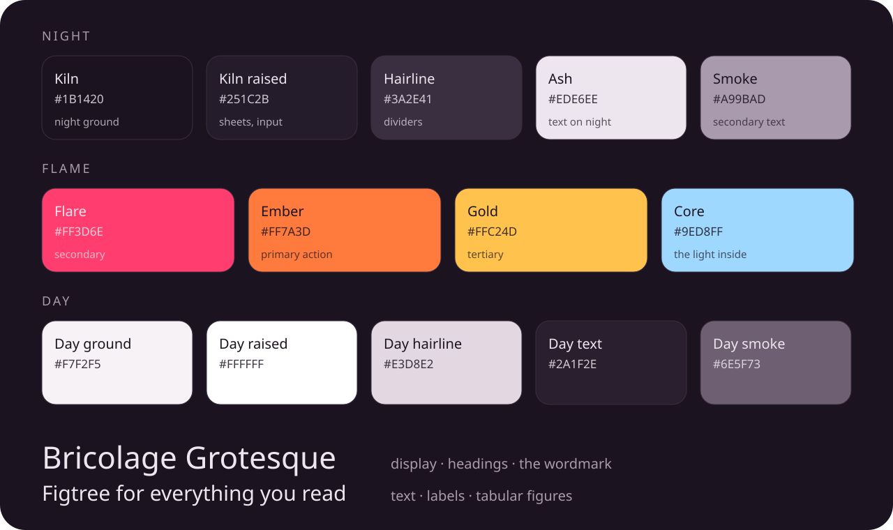

<p align="center">
  
</p>

<p align="center">
  
  
  
  
  
</p>

*Liyab* is Tagalog for **flame**.

Liyab is an inference engine for GGUF language models on phones and laptops, and a private assistant built on it. It
is written in C++20 and has no cloud dependency. Our aim is to be the reference engine for running open models on
whatever device is at hand. That means models larger than the device's RAM, on any phone, without heating it up, and
without a single byte of the user's data leaving the device.

Today a 22 GB mixture-of-experts model (**Qwen3.6-35B-A3B**) answers at **~9–10.5 tokens per second** from the
command line on a Snapdragon 8 Elite phone, and at **~7.5–9.4 tok/s in the app**. Its experts are streamed from flash
storage into the 6 GiB that Android lets one app use. A model that fits in RAM, **Qwen3.5-4B**, answers at **~12 tok/s**
from the command line and **~12–16 tok/s in the app**.

> **This README describes the code as it is.** Every feature listed here is implemented and tested; everything that
> is not lives in the [Roadmap](#roadmap). Numbers are measured on real hardware. Where a number comes from a single
> run, a hot phone or a different setup, the text says so.

---

## Contents

* [Why Liyab](#why-liyab)
* [Design principles](#design-principles)
* [What it does today](#what-it-does-today)
* [Quick start](#quick-start)
* [Architecture](#architecture)
* [Supported models](#supported-models)
* [Models larger than RAM](#models-larger-than-ram)
* [Context, memory and serving](#context-memory-and-serving)
* [Heat and power](#heat-and-power)
* [Speculative decoding](#speculative-decoding)
* [Embeddings and reranking](#embeddings-and-reranking)
* [Using the engine](#using-the-engine): C++, C ABI, Kotlin, Swift, command line
* [The Liyab app](#the-liyab-app): assistant, agent tools, local OpenAI / Anthropic / gRPC API
* [Look and feel](#look-and-feel): the living flame, colours, type
* [Measured results](#measured-results)
* [Experimental modules](#experimental-modules)
* [Testing](#testing)
* [Roadmap](#roadmap)
* [Known limitations](#known-limitations)
* [Project layout](#project-layout)
* [Contributing](#contributing)
* [License](#license)

---

## Why Liyab

Cloud assistants are capable, but they cannot read your messages, your calendar or your files without sending them
somewhere else. A model running on the phone can. That only works if the device can run a *strong* model, and do it
in a way people will tolerate: no waiting minutes for an answer, no phone burning in the hand, no battery gone by
lunch.

Phones are not small servers. Their memory is shared with everything else and capped per app (6 GiB on HyperOS). The
fast storage reads at ~4.4 GB/s, but only when the reads are large and concurrent. Sustained load hits thermal limits
within minutes. Every SoC has a different mix of CPU cores, GPU and NPU, and every model architecture stresses them
differently.

Liyab is built around those constraints:

* **Models larger than RAM are the normal case.** Dense blocks and MoE experts stream from flash, with direct I/O
  sized to what the storage likes. The expert cache predicts the next block's experts from the router and overlaps
  reads with compute. Memory is planned against the budget the OS really allows.
* **Heat is part of scheduling.** The engine reads the OS's thermal-headroom forecast. As pressure builds, it paces
  tokens and asks the governor for lower clocks, so the same tokens cost fewer watts. It does not run flat out and
  then collapse.
* **Serving a single user well.** Context is reused across turns, including the recurrent state of hybrid models.
  A prefix cache brings back earlier conversations. Prefill can be cancelled and resumed. Structured output covers
  tool calls. A local OpenAI, Anthropic Messages and gRPC API lets other apps on the device use the same model.
* **A private agent on top.** The Liyab app replaces the system assistant. It answers questions about your day from
  your own calendar, notifications, messages and calls, and nothing leaves the phone.

## Design principles

These rules decide what goes into the code:

1. **Generic and self-calibrating.** No optimization is tied to one SoC or one model. Thread counts, draft
   lengths, expert prefetch depth, context length, memory plans and thermal bands are measured or derived on the
   device the engine runs on.
2. **Kernels per instruction set, policy per platform.** Compute kernels target ISAs: ARM64 NEON with dot product
   and i8mm, x86-64 AVX2, Metal, Vulkan. Differences between operating systems (thermal APIs, performance hints, memory limits)
   live behind a thin adaptive layer, never in the kernels.
3. **Lossless by default.** Every speed-up that changes the output (fewer experts, requantization, skipping) is
   opt-in, labelled lossy, and measured with `liyab-kl` against the lossless path.
4. **Measured, not assumed.** Changes are judged by alternating A/B runs on a real phone. Ideas that did not pay off
   are documented, so nobody has to try them again blind.
5. **Private by construction.** The engine never touches the network. The app uses the network only to download
   models from Hugging Face.

---

## What it does today

| Area | Status |
| :--- | :--- |
| GGUF v2/v3 loader: `mmap`, zero-copy, validated against malformed files; split models (`-00001-of-0000N.gguf`) | ✅ |
| Architectures: `llama`, `mistral`, `qwen2`, `qwen3`, `qwen35` (hybrid Gated DeltaNet + attention), `qwen3moe`, `qwen35moe`, `hunyuan-dense`, `gemma2`, `gemma3`, `phi3`, `deepseek2` (multi-head latent attention) | ✅ cross-checked against llama.cpp or Hugging Face transformers |
| Every GGML tensor format (F32/F16/BF16, legacy Q4–Q8, K-quants, I-quants, TQ1_0/TQ2_0, MXFP4, NVFP4) | ✅ bit-exact against llama.cpp's reference decoder |
| Tokenizers: SentencePiece and byte-level BPE, pre-tokenizers as data (Qwen, Llama 3, GPT-2, DeepSeek, Hunyuan, Phi, Gemma) | ✅ token-identical to each model's Hugging Face tokenizer |
| Chat templates: the GGUF's Jinja template rendered by Liyab's own interpreter; layout of turns and prefix stability for context reuse | ✅ byte-identical to transformers' `apply_chat_template` |
| Models larger than RAM: dense blocks streamed by parallel `O_DIRECT` reads; MoE experts streamed into an LFU cache with router-predicted prefetch | ✅ automatic |
| Memory planning: per-app budget, automatic requantization only when the expert cache would be too small, recommended budget reported | ✅ |
| CPU backend: NEON + SDOT; i8mm (SMMLA) layouts for Q4_K/Q5_K/Q6_K/Q8_0; WFE-waiting thread pool with chunks claimed on demand | ✅ |
| CPU backend on x86-64: AVX2 + FMA + F16C kernels chosen at run time by CPUID, scalar fallback in the same binary | 🟡 tested under Rosetta 2 only |
| GPU backends: Metal (zero-copy on unified memory), Vulkan (Adreno/Mali; native kernels for 23 formats on GPU-shared memory) | ✅ |
| Paged KV cache (F16 / Q8_0 / Q4_0 / Q4_1) with per-channel key scaling, sliding window with attention sinks, grouped-query attention over spans, latent rows for multi-head latent attention | ✅ |
| Context kept between turns, recurrent-state snapshots for hybrid models, save/restore to disk | ✅ |
| Automatic context length from the KV cache's cost; cancellable, resumable chunked prefill | ✅ |
| Prefix cache across conversations (LRU of serialized contexts, in RAM or on storage) | ✅ |
| Speculative decoding: draft model, n-gram lookup or suffix drafts from this and earlier conversations, adaptive draft count, hybrid models included | ✅ |
| Structured output: grammar-constrained decoding (JSON Schema, grammar text) and forced continuations (tool-call syntax and names in the app) | ✅ |
| Embeddings and reranking: decoder embedding models and rerankers as their GGUF declares them (last-token or mean pooling, ranking heads, or LM-head labels), shared prefixes computed once | ✅ cross-checked against Hugging Face transformers |
| Heat and power: OS headroom forecast, adaptive pacing, ADPF performance hints, emergency guards, power profiles | ✅ |
| SoC detection (Snapdragon, Dimensity, Tensor, Exynos, Apple) and backend ranking | ✅ |
| Qualcomm QNN (Hexagon NPU), MediaTek NeuroPilot | 🟡 detected at runtime; compute falls back to GPU/CPU |
| Liyab app (Flutter): chat, model library with Hugging Face downloads, activity meters, settings, system assistant sheet (phone) or command bar (computer) | ✅ Android · ✅ macOS (Apple silicon) · 🟡 iOS app not built yet (the engine builds for iOS) |
| Agent tools: calendar, notifications (chats, email previews), SMS, calls, contacts, clipboard on Android; calendar, Apple Mail, Messages, calls, contacts, clipboard on macOS; each source opt-in | ✅ |
| Local API for other apps on the device: OpenAI, Anthropic Messages, gRPC; loopback only, token-protected, off by default; tools and JSON answers by constrained decoding | ✅ text (no images) |
| Voice, actions (alarms, events, replies), local memory/RAG | 🔜 [Roadmap](#roadmap) |
| Experimental: early exit, head pruning, EGLS, 2:4 sparsity, JIT unpacker, persistent KV prefix files, io_uring | 🧪 `LIYAB_ENABLE_EXPERIMENTAL` |

---

## Quick start

Requirements: CMake ≥ 3.22, a C++20 compiler (Clang 17+ / Apple Clang 15+), Ninja recommended. Android: NDK r26+.
iOS: Xcode 15+. The app: Flutter 3.x, Android SDK platform 36, JDK 17.

```bash
# Build and test on the host (macOS / Linux)
cmake -S . -B build -G Ninja -DCMAKE_BUILD_TYPE=Release   # add -DLIYAB_ENABLE_EXPERIMENTAL=ON for experimental modules
cmake --build build
ctest --test-dir build --output-on-failure

# x86-64 build on an Apple-silicon Mac, run under Rosetta 2. Rosetta executes AVX2 but reports it in CPUID only
# with ROSETTA_ADVERTISE_AVX=1; without it the scalar kernels run
cmake -S . -B build-x86 -G Ninja -DCMAKE_OSX_ARCHITECTURES=x86_64 -DCMAKE_BUILD_TYPE=Release
cmake --build build-x86
ROSETTA_ADVERTISE_AVX=1 ctest --test-dir build-x86 --output-on-failure

# Run a model
./build/liyab-cli -m model.gguf -p "Explain unified memory in one paragraph." -n 128
./build/liyab-cli --device                                 # what Liyab sees: SoC, accelerators, backend ranking
```

```bash
# Android (arm64-v8a): libliyab.so, liyab-cli and the tests in build/android/arm64-v8a
scripts/build_android.sh                     # --experimental, --abi, --api, --ndk, --no-vulkan, ... (see --help)

# iOS: build/ios/Liyab.xcframework (device arm64 + simulator arm64/x86_64), importable from Swift as `Liyab`
scripts/build_ios.sh

# The Liyab app: builds libliyab first, then the release APK; --install waits while the app is in use
scripts/build_flutter_app.sh --install

# The Liyab app for macOS (Apple silicon): app/build/macos/Build/Products/Release/Liyab.app
scripts/build_flutter_app.sh --macos
```

The Android NDK is located from `--ndk`, `$ANDROID_NDK_HOME`, or the newest NDK in the usual SDK locations. The
`.so` is linked with 16 KB page alignment, which Android 15+ devices with 16 KB pages require. If `xcodebuild`
reports missing components, run `sudo xcodebuild -runFirstLaunch` once.

### CMake options

| Option | Default | Effect |
| :--- | :--- | :--- |
| `LIYAB_USE_NEON` | ON on arm64 | NEON intrinsics kernels |
| `LIYAB_ARM_DOTPROD` | ON on arm64 | `-march=armv8.2-a+dotprod+fp16` on Android/iOS/Linux (SDOT) |
| `LIYAB_USE_AVX2` | ON on x86-64 | AVX2 + FMA + F16C kernels, used when CPUID reports them (the library itself keeps the x86-64 baseline) |
| `LIYAB_USE_METAL` | ON on Apple | Metal GPU backend |
| `LIYAB_USE_VULKAN` | ON on Android | Vulkan GPU backend and probe (loader opened with `dlopen`; shaders need `glslc` from the NDK or the Vulkan SDK) |
| `LIYAB_USE_QNN` / `LIYAB_USE_NEUROPILOT` | ON on Android | NPU runtime probes (no SDK needed) |
| `LIYAB_ENABLE_EXPERIMENTAL` | OFF | [Experimental modules](#experimental-modules) and `test_experimental` |
| `LIYAB_BUILD_SHARED` | ON | Shared (`.so`/`.dylib`) or static library |
| `LIYAB_BUILD_TESTS` / `LIYAB_BUILD_CLI` | ON | Unit tests, benchmarks and `liyab-cli` |

---

## Architecture

```
   Liyab app (Flutter, dart:ffi) · Kotlin (JNI) · Swift · C++ · other apps via the local API
                                     │
                         liyab_c_api.h  (stable C ABI)
                                     │
  ┌──────────────────────────────────▼──────────────────────────────────────────┐
  │ Engine                                                                      │
  │  ├─ Context manager ── turn-to-turn reuse, state snapshots, prefix cache,   │
  │  │                     cancellable chunked prefill, save/restore            │
  │  ├─ Generation ─────── sampler, grammars, forced text, speculative decoding │
  │  ├─ PowerManager ───── headroom forecast, pacing, performance hints, guards │
  │  ├─ DeviceDetect ───── SoC + accelerator probes → backend ranking           │
  │  └─ Transformer ────── per block: mixer (attention | Gated DeltaNet)        │
  │                        + FFN (dense | MoE), paged KV cache, recurrent state │
  └──────────┬───────────────────────────────────────────┬──────────────────────┘
             │ weights                                   │ matmuls (per-op route)
  ┌──────────▼─────────────────────────────┐   ┌─────────▼────────────────────────────┐
  │ MmapLoader      zero-copy GGUF, splits │   │ CPU   NEON · SDOT · i8mm · AVX2 ✅   │
  │ DirectFile      parallel O_DIRECT      │   │ GPU   Metal ✅ · Vulkan ✅            │
  │ TripleBuffer    streamed dense blocks  │   │ NPU   QNN · NeuroPilot (probe) 🟡    │
  │ ExpertStore     MoE expert cache:      │   │ fallback per matmul: NPU → GPU → CPU │
  │   LFU, prediction, size classes,       │   │ GPU-shared memory: the GPU reads     │
  │   repack on read, hot-list warmup      │   │ weights where storage wrote them     │
  └────────────────────────────────────────┘   └──────────────────────────────────────┘
```

* **Zero-copy weights.** `MmapLoader` maps the GGUF file read-only. Every tensor is a view into the mapping, and the
  CPU kernels read quantized blocks in place. On Apple Silicon each tensor is wrapped in an `MTLBuffer` with
  `newBufferWithBytesNoCopy`, so the GPU reads the page cache directly.
* **One forward pass for every architecture.** The transformer is not written per model. For each block the loader
  picks the token mixer from the tensors present (`ssm_conv1d` → Gated DeltaNet, `attn_kv_a_mqa` → multi-head latent
  attention, otherwise softmax attention) and detects optional pieces (QKV biases, Q/K norms, an attention output
  gate, the pre-FFN norm, norms after the attention and the FFN). The facts the tensors cannot tell are one row per
  architecture: whether Q/K norms come before or after RoPE, the FFN's activation (SwiGLU or GeGLU), whether
  embeddings are scaled, which blocks attend through a sliding window and with which RoPE base. The FFN is a mixture
  of experts when the block has a router. Scalars a model states in its file (RoPE scaling, soft caps, the q·k
  scale) are read from it. See [Supported models](#supported-models).
* **Per-operation routing.** Attention projections can go to the GPU and the FFN to the NPU. A backend that reports
  `Unsupported` for a matmul falls back to the next one for that matmul only.
* **Vulkan on phones.** Mobile drivers lack `VK_EXT_external_memory_host` (Adreno 830 included), so mapped weights
  cannot be wrapped in place. Liyab has two paths:
  * Streamed models: weights are placed in host-visible, device-local, coherent and cached memory. On Adreno that
    is the same RAM, and direct reads from storage land there. Native kernels (`shaders/matvec_native.comp`, 23
    formats) decode the GGUF blocks in place.
  * Models that fit: each tensor is copied once into GPU memory and repacked (`shaders/matvec.comp`).

  Kernels are compiled with `glslc` and embedded at build time. Matmuls that share an input go out in one submission,
  and a dispatch costs 0.055 ms.
* **Paged KV cache.** Fixed 64-token pages, covering every layer, come from a pool on demand through a page table.
  Memory follows the positions actually used, and freed pages are reused exactly. Sliding windows keep the first
  `kv_sink_tokens` positions (attention sinks, default 8) plus the last *N*. Blocks the model itself windows (Gemma
  2's and 3's local layers) see only their last *W* positions of what the cache keeps; their rows stay in the shared pages,
  so they save attention work, not memory. Multi-head latent attention caches one row per position and block, its
  RoPE key and its latent, and reads the values from the latent channels of that row
  ([Supported models](#supported-models)). Attention scores a KV head's whole query
  group at once, and each V row is dequantized once per group. On a 2,812-token context this cut attention from 67.6
  to 44.4 ms per token on the 35B. Each token's visible positions are cut into up to 84 equal spans of at least 32
  positions, merged in order with log-sum-exp. While decoding, the spans of the one token are the tasks every
  thread shares (168 on two KV heads, an even split for 1 to 4 and 6 to 8 threads). The cut follows the token's own
  position, never the batch or the threads, so its attention is the same bits however the prompt was split.
* **Key scaling for quantized KV caches.** A quantized cache stores each key row in blocks of 32 values that share
  one scale, set by the block's largest value. Some model families carry a few key channels far larger than the
  rest and nearly constant across tokens: about −130 where the others are about 1 on Qwen2.5, up to ~300 on Qwen3.
  The small values sharing their block were then rounded with a step a hundred times too coarse, and almost all of
  a Q8_0 cache's error came from there. Attention only needs q·k, and q·k = (q∘t)·(k/t) for any positive
  per-channel t, so keys are stored divided by t and queries multiplied by it. Each channel then has the same range
  on both sides and the products are unchanged.
  * **Measured once per model**, on a short fixed text (about 45 tokens: prose, code, numbers, several scripts).
    For each channel, t takes the largest value the keys and queries reach at any position up to 32,768: RoPE turns
    each pair of channels by a known angle per position, so that range is exact even though the text covers only a
    few positions. Ranges are floored at a quarter of their head's median and t is bounded, so a channel the text
    barely reached cannot get an extreme factor.
  * **Only where it helps.** A model is scaled when some head's largest key channel reaches 12 times its median
    channel: Qwen3-0.6B 107×, Qwen3-4B 87×, Qwen2.5-0.5B 52×. Below that (Qwen3.5-0.8B 10.5×, the Qwen3.6-35B
    MoE 7.4×, Qwen3.5-4B 7.5×, Llama 3.2 6.3×) scaling moved the KL against F16 only within noise, sometimes up,
    so those models keep their keys as computed, bit for bit. The first 12 tokens decide for most models; the
    rest of the text is processed only for those that need factors.
  * **Cost.** On the phone: 0.27 s for Qwen3.5-4B, 1.4 s for the 35B MoE (its experts are read from storage), 7.4
    s for a dense 27B larger than RAM, 1.4 s for Qwen3-4B, which is scaled. `EngineConfig::cache_dir` keeps the
    result (a few KB per model, the 16 most recently used models), so only a model's first load pays for it. The
    factors depend only on the model, the cache format and the kernel set, never on the backends or the configured
    context, so a prompt gets the same reply in every process. With the factors kept, speed is unchanged (A/B on
    the phone, 35B: decode 10.2 vs 10.0 tok/s, first token 5.8 vs 6.0 s).
  * **Saved contexts** carry the factors their keys were stored with; one saved with others (or before key scaling
    existed) is converted when loaded instead of being processed again.

  Measured against F16 ([Correctness](#correctness)): Q8_0 keys went from a mean KL of 0.070 to 0.0018 on
  Qwen2.5, 0.051 to 0.0021 on Qwen3-0.6B and 0.015 to 0.0063 on Qwen3-4B, with the same memory and kernels.
* **x86-64 kernels.** One binary runs on any x86-64 CPU. The library is compiled for the x86-64 baseline; the AVX2
  kernels (`src/core/quant_x86.cpp`) carry a per-function `target("avx2,fma,f16c")` attribute and run only when
  CPUID reports AVX2, FMA and F16C and the OS saves the 256-bit registers (Intel Haswell and AMD Zen onwards).
  The choice is made once per process; `LIYAB_KERNELS=scalar` forces the scalar set and `quant::kernel_isa()`
  reports `avx2` or `scalar`. They cover Q8_0 (single and multi-row), Q4_0, Q4_1, Q5_0, Q5_1, IQ4_NL and MXFP4
  against Q8_0 activations; Q4_K, Q5_K, Q6_K (1 to 4 rows per weight decode) and IQ4_XS against Q8_K; F32, F16
  and BF16 dots; Q8_0 / Q8_K activation quantization; F16 encoding and the F16, BF16, Q8_0, Q4_0, Q4_1 decodes
  of the KV cache and embeddings. The int8 products use `VPMADDUBSW` (|w| times x with w's sign, which cannot
  saturate because activations stay in [-127, 127]) and `VPMADDWD` against the sub-block scale, so a K-quant
  super-block accumulates exactly in int32. Q8_0 and the K-quants then apply the same float epilogues as the NEON
  kernels in the same order, so a row's result does not depend on the batch, and activation quantization and
  decoding give the scalar code's bits.
* **Thread pool.** Workers wait for the next job in `WFE` on ARM64: the core sleeps until the job word changes, with
  no instructions issued, instead of spinning at full clock; on x86-64 they spin with `PAUSE`. They block on a
  condition variable after 300 µs idle. A job is split into 4 chunks per thread, claimed on demand, so a preempted
  core does not hold up a whole matmul. Matmuls that share an input run as one group, and MoE experts run in waves:
  two fork/joins per wave instead of two per expert.

---

## Supported models

* **Format:** GGUF v2/v3, a single file or split with `gguf-split`. Open part 1; the other parts must sit next to it
  under their original names.
* **Architectures:**
  * `llama` (Llama 1/2/3.x, Mistral, TinyLlama…), `mistral`, `qwen2`, `qwen3`;
  * `qwen35`: Qwen3.5 / Qwen3.8 hybrids, with three Gated DeltaNet blocks per gated-attention block. The
    multi-token-prediction head is skipped;
  * mixture-of-experts: `qwen3moe` (Qwen3-30B-A3B…) and `qwen35moe` (Qwen3.5/3.6-35B-A3B…);
  * `hunyuan-dense` (Hunyuan-MT-7B, Hunyuan 0.5B–7B): Q/K norms after RoPE. Its dynamic-NTK "alpha" RoPE scaling
    is already folded into `rope.freq_base` by the GGUF converter. Its `hunyuan` / `hunyuan-dense` pre-tokenizers
    are table rows (below). A prompt must start with its BOS token, which the GGUF does not ask the tokenizer to
    add;
  * `gemma2` (Gemma 2): embeddings scaled by √d, GeGLU, norms after the attention and the FFN, every other block
    (the even ones) through the sliding window, and soft caps on the attention scores and the logits
    (cap · tanh(x / cap), from the file's `attn_logit_softcapping` and `final_logit_softcapping`);
  * `gemma3` (Gemma 3 text models): embeddings scaled by √d, GeGLU, norms after the attention and the FFN, Q/K
    norms, five sliding-window blocks (RoPE base 10,000) per global block (the file's base and scaling). The GGUF
    stores its RMSNorm weights as 1 + w already, for Gemma 2 too;
  * `phi3` (Phi-3, Phi-3.5, Phi-4-mini): fused `attn_qkv` and `[gate | up]` projections, partial rotation, LongRoPE;
  * `deepseek2` (DeepSeek-V2-Lite, DeepSeek-V3-structured models with one expert group, and the models converted to
    their architecture, such as Youtu-LLM-2B): multi-head latent attention, queries from one projection or a
    low-rank pair with its norm, dense FFNs in the leading blocks and MoE with shared experts in the others (from
    the tensors), YaRN with its log multiplier. Attention runs in the absorbed form: each head's query is projected
    onto the latent once (`attn_k_b`), so all heads attend over one cached row per position and block,
    `[k_pe | latent]` (576 values on DeepSeek-V2-Lite instead of the 5,120 of per-head keys and values), whose
    latent channels are the values; the weighted latent is then expanded per head (`attn_v_b`). Queries are scaled
    for the per-head width the model was trained with (1/√192 there). Key scaling covers the latent too and
    multiplies the attention output back. Files converted before `attn_kv_b` was split into `attn_k_b` and
    `attn_v_b` are refused with a request to convert them again, and so is group-limited expert routing
    (`expert_group_count` > 1: DeepSeek-V2 236B, V3 and R1).

  Linear RoPE scaling, Llama 3.x `rope_freqs`, LongRoPE and YaRN are supported, and windowed blocks can rotate with
  a RoPE base of their own. LongRoPE picks its factors once, from the configured context: the short ones up to the
  model's original context (4,096 on Phi-3.5), where the result is the reference's, and the long ones beyond it from
  the first position on (the reference switches when the sequence grows past it, rotating earlier keys again).
  YaRN is read from the file's `rope.scaling.*` keys (factor, original context, `yarn_beta_fast` / `yarn_beta_slow`,
  `yarn_ext_factor`, `yarn_truncate`, `yarn_attn_factor`, `yarn_log_multiplier`): each rotary pair's frequency is
  blended between its own and the one divided by the factor along the reference's ramp, and queries and keys get
  its attention factor (0.1 ln factor + 1 unless the file states one). It does not depend on the context length,
  so one table serves every position. The q·k scale is the file's `attention.scale` when it has one, else 1/√head_dim.
  `liyab_supported_architectures()` lists what a build runs, so front ends can filter downloads.
* **Embedding models and rerankers** built on these architectures (Qwen3-Embedding, Qwen3-Reranker) run as their
  GGUF declares them: see [Embeddings and reranking](#embeddings-and-reranking). Encoder-only models (BERT, XLM-R)
  are not supported.
* **MoE details:**
  * softmax or sigmoid gating, optional selection bias, top-k, renormalization and scale from the metadata;
  * an optional shared expert with a sigmoid gate;
  * each expert's gate and up projections as two tensors or as one `[gate | up]` tensor (`ffn_gate_up_exps`,
    written by converters that fuse them); the fused rows are the split ones, so the logits are the same bits;
  * the tokens of a batch are grouped per expert, so each expert is read once.
* **Hybrid models:** DeltaNet blocks keep a recurrent state: conv history plus one 128×128 matrix per value head.
  These models can roll back only:
  * inside a window of state checkpoints (used by speculative decoding), or
  * to one of four state snapshots (the oldest, the end of the last prompt, and the two newest others).
* **Tensor types:** every format llama.cpp writes, mixed freely per tensor:
  * F32, F16, BF16;
  * Q4_0/Q4_1/Q5_0/Q5_1/Q8_0;
  * Q2_K…Q6_K (and the S/M/L mixes);
  * IQ1_S/M, IQ2_XXS/XS/S, IQ3_XXS/S, IQ4_NL/XS;
  * TQ1_0/TQ2_0, MXFP4, NVFP4.

  Decoders are ported from llama.cpp's gguf-py reference, and `test_engine` checks all 24 formats bit-exactly against
  `tests/data/quant_vectors.bin`.
* **Kernels:**
  * Q4_0/Q4_1/Q5_0/Q5_1/Q8_0 have NEON + SDOT kernels that unpack bits in registers.
  * K-quants, TQ2_0 and I-quants use NEON kernels adapted from llama.cpp (`src/core/quant_lowbit.cpp`) against
    Q8_K activations, so a whole super-block accumulates in int32.
  * IQ4_NL and MXFP4 use table lookups.
  * With i8mm, resident Q4_K/Q5_K/Q6_K/Q8_0 matrices are rearranged losslessly at load into 8-row (4-row for Q8_0)
    interleaved layouts. One SMMLA then multiplies 8 weight rows by 4 activation rows.
  * Every kernel of a format ends each block the same way: exact integer sums, then the same fused multiply-adds in
    the same order. That holds on the file's layout or repacked, for one activation row or several. A row's result
    is then the same bits whichever kernel computed it, so logits depend neither on the batch size nor on the layout
    (tested for every format).
* **Tokenizers:** SentencePiece (`llama`: Llama 2, Mistral, Gemma, Phi-3) and byte-level BPE (`gpt2`).
  * **Pre-tokenizers are data.** Before merging, a byte-level BPE tokenizer cuts the text into pieces with regular
    expressions. Each scheme is one row of a table keyed by the GGUF's `tokenizer.ggml.pre`
    (`src/core/pre_tokenizer.cpp`): the patterns of the model's own `tokenizer.json`, NFC normalization where it
    asks for it (Qwen), and whole-piece vocabulary lookup before merging (Llama 3, Hunyuan). Rows: `default` /
    `gpt-2` / `gpt2` / `phi-2`, `llama-bpe` / `llama3`, `qwen2` / `deepseek-r1-qwen`, `qwen35`, `hunyuan`,
    `hunyuan-dense` / `deepseek-v3`, `deepseek-llm` and `gpt-4o` (Phi-4-mini). A GGUF without the key uses
    `default`. Any other value is an error naming it and the supported list; the model still loads and runs on
    token ids.
  * **Liyab's own regex engine** (`src/core/regex.cpp`) runs the patterns: Unicode general categories (`\p{L}`,
    `\p{Lu}`, `\P{N}`…), classes, alternation, greedy, lazy and possessive quantifiers, case-insensitive groups,
    lookahead and atomic groups. It decodes the text once into code points with a category key each, so a class
    test is a bit lookup. The Unicode data (categories, NFC tables) is generated into `src/core/unicode_tables.inc`
    by `tools/gen_unicode_tables.py`.
  * **Special tokens** written in the text map to their ids, found in one pass over the text. Those of the Phi-3
    family (Phi-3/3.5, Phi-4-mini) swallow the white space after them, as their Hugging Face tokenizer does. A
    byte a vocabulary lacks (Hunyuan's dense models have no `\r`) is left out before merging, as there.
  * **Checked token for token** against each model's Hugging Face tokenizer, special tokens, contractions,
    digits, white-space runs, composed and decomposed accents, CJK, emoji and right-to-left text included
    ([Correctness](#correctness)).
  * **Speed.** Tokenizing sits on the typing path (prompts are encoded while the user writes). Merges compare token
    ids through a heap, never strings, so a long piece costs O(n log n). On an Apple M4 Pro a 68 KB text encodes in
    2.4–3.6 ms (19–28 MB/s, Qwen3, Qwen3.5, Llama 3.2) and an 80 KB conversation full of special tokens in 2.5–3.2 ms.
* **Chat templates from the model.** Every GGUF carries the Jinja chat template of its Hugging Face tokenizer
  (`tokenizer.chat_template`). Liyab's own Jinja interpreter (`src/core/chat_template.cpp`) renders it the way
  transformers' `apply_chat_template` does: the same whitespace rules, Python's printing, `tojson`,
  `raise_exception`, `strftime_now`, loops with `loop.previtem` / `nextitem`, macros, namespaces, string methods and
  the usual filters and tests, and the sandbox's refusal of methods that change a list or dict.
  * `Engine::render_chat` (C: `liyab_engine_render_chat`) takes the request as JSON: `messages`, optional `tools`
    and `add_generation_prompt`, and any template variable such as `enable_thinking`. A text that starts with the
    BOS token's own text (Llama 3, Gemma) gets no second BOS when tokenized.
  * `Engine::chat_format` (C: `liyab_engine_chat_format`) renders probe conversations and reports how the template
    lays out turns: the system block, what opens and closes a user turn, the generation prompt and what ends a
    reply. It also says whether the template is **prefix-stable**: rendering *n* turns, then the reply, must be the
    start of rendering *n* + 1 turns, which context reuse across turns needs. Llama 3, Qwen2.5, Gemma 3, Phi-3.5,
    Phi-4-mini, Hunyuan-MT, DeepSeek V3.1, and Qwen3.6 with `preserve_thinking`, are. Qwen3 and Qwen3.5 are not:
    they drop the reasoning of earlier replies once the conversation goes on. The load log says which.
  * Checked byte for byte against transformers on 14 conversations per template (system, user, assistant and tool
    turns, tools, inline and separate reasoning, thinking on and off, no system message, non-ASCII and white space
    at the edges), for Qwen2.5, Qwen3, Qwen3.5, Qwen3.6, Llama 3.2, Gemma 3, Phi-3.5, Phi-4-mini, Hunyuan-MT,
    Hunyuan-0.5B, Hunyuan-A13B and DeepSeek V3.1: 165 renders identical, and the 3 conversations transformers
    refuses refused too (`tests/data/chat_templates.json`, written by `tools/chat_template_reference.py`). The
    templates the GGUFs themselves carry gave the same 168 results.
* **Prompts are used as given** by `generate()` and `prefill()`: render them with the template first (the app does).

---

## Models larger than RAM

Streaming switches on automatically when a model does not fit, that is, when the file is larger than 80% of the
available memory or of `memory_budget_mb`.

* **Storage that is fast only when used right.** UFS 4 reaches ~4.4 GB/s with 2–4 direct requests of ≥ 256 KiB in
  flight, random or sequential alike, but stays under 1.2 GB/s with 16 KiB requests (see the
  [flash chart](#charts)).
  * `DirectFile` reads with `O_DIRECT`, so there is no page-cache copy and resident weights are not evicted. It
    splits large reads into concurrent 4 MiB requests.
  * On FUSE (Android's `/storage/emulated`), direct reads were seen to return success without the file's bytes, so
    Liyab never uses them there, and it self-tests direct against buffered reads before trusting any file.
* **Dense models.** As many blocks as fit stay resident. The others stream through a 3-slot pipeline (fetch →
  prepare → execute), spread evenly through the stack so storage keeps reading while resident blocks compute. With
  Vulkan, slots and resident blocks live in GPU-shared memory, where the native kernels decode them in place.
* **Mixture-of-experts models.** Everything but the routed experts stays resident. Experts go through the
  `ExpertStore`:
  * **A RAM cache sized by the memory plan.** It holds one entry per expert (gate/up/down) in slot size classes per
    matrix layout. Eviction is LFU with periodic halving. A freshly loaded expert is not evicted before the block it
    was loaded for has used it.
  * **Prediction one block ahead.** After a block's mixer, the next block's router is applied to the residual stream
    and the experts it picks are prefetched, ordered by rank and only while that rank's guesses pay off. On
    Qwen3.6-35B-A3B about 79–83% of guesses are chosen. Wrong guesses are settled as soon as the real router
    chooses: queued ones are dropped, and ones already read become the next to evict.
  * **Reads shaped for flash.** Four I/O threads read the experts. The thread that starts an expert reads its gate
    matrix and hands up and down to idle threads, so a waiting forward pass gets its expert after one matrix's read
    instead of three. A fused `[gate | up]` matrix is contiguous per expert: one read, then down, two in all.
  * **Compute that overlaps I/O.** Experts already in RAM run first, in one batched pass (gate/up, then down). The
    shared expert runs while the routed ones wait for a read.
  * **Batch-aware.** For a multi-token pass (prefill), experts are rearranged into the i8mm layouts on the I/O
    thread as they arrive. Prefill runs in passes of 1,024 tokens, each reading the union of its tokens' experts
    once. Such passes give the experts no LFU credit, so a long prompt does not evict the experts a conversation
    keeps using.
  * **Deterministic.** Each token's expert outputs are added in router order, whatever order they arrived in, and a
    repacked expert rounds like one in the file's layout. Results therefore depend neither on I/O timing nor on what
    the cache held: streamed and in-place experts give bit-identical logits (tested).
* **Memory plan.** `Engine::memory_plan()` reports the resident bytes, the experts' bytes, the expert cache and the
  budget at which 15% of the experts would be cached, so a front end can tell the user when a budget is too small.
  With `requant_bits = -1` (the app's default), resident Q8_0 matrices are converted to Q5_K or Q4_K at load **only**
  when the expert cache would otherwise hold under 10% of the experts. That is the point where nearly every token
  would wait on storage.
* **Optional lossy trade-offs**, all measured with `liyab-kl` (see [results](#qwen36-35b-a3b-a-22-gb-moe-on-a-phone)):
  * `requant_bits` 4/5: fewer resident bytes;
  * `moe_expert_mass`: run only the top experts covering a share of the router weight;
  * `moe_max_experts`: cap the experts per token;
  * `moe_skip_slow`: skip a light expert that is not in RAM yet instead of waiting for it (replies then depend on
    I/O timing).

---

## Context, memory and serving

A phone serves one user, but that user switches conversations, types, leaves the app and comes back. Liyab treats
each of those as a scheduling problem.

* **Context reuse across turns.** When a prompt continues the text the engine already processed (the previous prompt
  plus its reply, which is how a chat grows), that text keeps the tokens it was processed as. Only the rest is
  computed, recurrent DeltaNet states included. Re-encoding a reply need not reproduce the generated tokens (around
  `</think>`, for example), and that no longer forces a restart. The engine keeps knowing which text its tokens
  encode through work that is cancelled or cut short (a prefill typed ahead, a reply stopped while its prompt is
  processed), through rewinds and through `save_state()`. A prompt that leaves that text partway (a draft edited, a
  message prepared ahead then typed over) keeps its tokens up to where the texts part. When that text ends inside a
  character (a model may write one in two byte-level tokens), the tokens step back to the last whole character
  instead of the prompt being encoded again. Otherwise the longest common
  token prefix is kept: any length on attention-only models, and back to the nearest state snapshot on hybrid ones;
  the log says at which token a prompt left the context. On the 35B, follow-up turns start in ~1.1–1.6 s instead of
  reprocessing the conversation.
* **State snapshots for hybrid models.** Four are kept: the oldest one, the end of the last prompt (pinned, so
  background drafts cannot evict it), and the two newest others (a draft's words and the whole draft after them).
  They are set aside from the expert cache's budget (62.8 MiB each on the 35B).
* **Prefix cache across conversations** (`prefix_cache_mb`). A context that an unrelated prompt replaces is kept in
  RAM as a serialized state (KV pages plus recurrent states) with the text it encodes, in an LRU of at most that
  size. The whole context is kept, the last reply included, with a hybrid model's state snapshots (the last
  prompt's end among them). A later prompt that continues that text is restored, cut back to where the two diverge,
  instead of being processed again, even when its earlier replies would encode to other tokens. The output equals
  that of a context never interrupted (tested on attention-only and hybrid models). A 2,000-token conversation on
  the 35B costs ~85 MiB, plus 62.8 MiB per state snapshot kept. In RAM (`prefix_cache_mb`) the cache comes out of
  the memory budget; on a MoE whose experts stream, only as far as the expert cache can spare above 10% of the
  experts, so it never causes a requantization. On storage (`prefix_cache_dir`, `prefix_cache_disk_mb`) it costs no
  RAM at all: contexts that RAM does not hold go to files, least recently used out first. On the phone a 4,907-token chat on the 35B (114 MiB) was set aside in 81 ms and
  restored in 95 ms, where processing a 4,009-token one again had taken 163 s.
* **Cancellable, resumable prefill.** `cancel_prefill()` stops a background prefill between blocks, within a fraction
  of a second even inside a 1,024-token pass, and keeps the work done. The next prompt continues from there. A user
  request therefore never waits behind background work.
* **Automatic context length.** With `context_length = 0`, the context is what 256 MiB of KV holds: 4,096 to 32,768
  positions, at most the training context. That is ~24k on Qwen3.6-35B-A3B (only 10 of 40 blocks have a KV cache)
  and 4,096 on a dense 4B.
* **Save and restore.** `save_state()` / `load_state()` write the context to a file (KV pages, recurrent states, and
  the tokens and text they encode) and restore it in a later process. This works only for the same model file and
  cache layout, which a fingerprint checks. A long system prompt is processed once, not after every start. On hybrid
  models the file also keeps two state snapshots, the oldest and the last prompt's end (62.8 MiB each on the 35B), so
  a restored context rewinds where the live one would. The next prompt re-sends the last reply as text, which may
  encode differently from the tokens generated; without that snapshot the whole conversation was processed again
  (a 1,436-token chat: 60 s to the first token). The file also records the key scales its KV pages were stored with;
  a context saved with other scales, or before key scaling existed, has its keys converted when loaded, so an
  upgrade does not process saved conversations again.
* **Giving memory back.** `trim_memory()` empties the expert cache while idle, and drops constrained decoding's
  caches (rebuilt on the next constrained generation); the model and its context stay loaded. Its hot list survives: `warm_memory()` refills the cache in one background pass of large reads (~0.7 s for
  2.4 GB), and `save_expert_profile()` / `load_expert_profile()` carry the list to a later process.
* **Structured output.** `generate()` takes an optional `ForceCallback`. After each piece it sees the output so far
  and may return text the output must continue with. The engine runs that text through the model in one batched
  pass, like a short prefill, and emits it as output. That pass also gives the logits of the token after the forced
  text, which is sampled from them, so forced text costs no decoding step of its own (the CPU backend computes a row
  the same bits in any batch, so the output is the same as with a separate step). The app uses this to force the
  fixed syntax of tool calls and to complete a tool name as soon as only one fits. It works with speculative
  decoding too: the callback is asked after every token, and tokens a step verified past a forced point are rolled
  back. Forced text that ends inside a character is emitted up to it, the rest with the token that completes it.
  Forced tokens are counted apart from sampled ones, with the time their passes took, and
  `GenerationStats::decode_passes` counts the model's passes while decoding. On the 35B with streamed experts, a tool call's 9 forced tokens took 1.52 s against ~1.66 s to
  sample them: a batched pass reads the union of its tokens' experts, so what forcing buys there is a call that
  always parses, not speed.
* **Constrained decoding.** `generate()` also takes `GenerateOptions`: a grammar the whole output must match, or a
  `ContinuationCallback` that forces text and opens constrained spans where it chooses (a tool call's arguments,
  between forced syntax). While a grammar is active, every token whose bytes it cannot accept is masked before
  sampling, so the output always matches. Grammars come from a JSON Schema (the subset tool parameters and response
  formats use: objects, required and optional properties, enums, `$ref`, integer and number ranges, string lengths
  and formats; see `include/liyab/grammar.h`), any JSON, or grammar text in a GBNF-like syntax with `%json`,
  `%schema`, `%string` and `%until`. A schema keyword Liyab cannot enforce (`pattern`, `uniqueItems`...) is refused
  with an error naming it and where it is, never ignored.
  * **How.** Liyab's own grammar engine lowers rules to a byte-level pushdown automaton: UTF-8 classes become byte
    sequences, so a token may end inside a character, and a matched text is always valid UTF-8. The set of parse
    stacks the output allows is interned as a state, and byte transitions between states are cached: inside a
    string a transition is one table lookup. The vocabulary is a trie in depth-first order; a state's mask is one
    pass over it that skips every subtree whose prefix the state rejects, and is cached per state. Greedy and top-k
    sampling skip the mask altogether: the likeliest tokens are checked one by one until the k best allowed ones
    are found, which leaves exactly what masking then keeping the top k would.
  * **Forced, not sampled.** Text every continuation shares (keys, separators, brackets, the rest of the only enum
    value that fits) is forced in one batched pass, as forced continuations are. JSON is laid out as `json.dumps`
    writes it (`", "` and `": "`) by default, so the model samples only values and choices; any white space is an
    option. End-of-generation tokens are allowed only where the grammar accepts, and a whole-output grammar ends the
    generation as soon as its match is complete.
  * **Cost.** On an M4 Pro (Qwen3-0.6B, Qwen3.5-0.8B, Llama 3.2 1B, Qwen2.5-0.5B), constrained decoding cost
    0.14–0.24 ms per token greedy, 0.25–0.62 ms with top-k sampling, and 0.09–0.12 ms with whole masks once a
    state's mask is cached, against decode steps of 18–92 ms. A state's first whole mask takes 1.5–2.7 ms (inside a
    string, where nearly every token is allowed). The vocabulary trie is built on the first constrained token:
    333,000 nodes in ~30 ms for Qwen3's 151,000 tokens, 592,000 nodes in ~45 ms for Qwen3.5's 248,000. The engine
    keeps the states and masks of the 16 grammars used last (32 MiB per grammar, 64 MiB together), so a request with
    the same tools does not pay for them again. `GenerationStats::constrained_tokens` and `grammar_ms` report the
    cost of each generation, and `test_grammar` measures it on any GGUF (`LIYAB_GRAMMAR_MODEL`), together with a
    tool call made the way the local API makes one: Qwen3-0.6B (JSON calls) and Qwen3.5-0.8B (XML calls) wrote
    valid calls in every run.
  * **Speculative decoding** is off while a grammar is active (drafts would need a mask at every verified position);
    the unconstrained parts of the same generation use it.

---

## Heat and power

A phone that gets hot slows down by itself, and gets slower still once the OS steps in. Liyab steers before that
happens.

* **Forecast, not reaction.** While the engine processes a prompt or generates, a polling thread reads the
  following once a second:
  * the OS thermal status (Android `AThermal_*`, Apple `NSProcessInfo.thermalState`);
  * Android's thermal-headroom forecast 10 s ahead (Android 12+, smoothed);
  * the sysfs skin and SoC zones.

  Idle, it reads nothing. One reading costs ~10 ms of CPU and ~25 wakeups on a Snapdragon 8 Elite, which a loaded
  but unused model would otherwise pay every second (about 1% of a core, the screen off included).

  The forecast becomes a pressure from 0 to 1 over a band set by the power profile: Performance 0.75–0.95, Balanced
  0.65–0.90, LowPower 0.35–0.60. A cooler profile reacts earlier.
* **Same tokens, fewer watts.** From a pressure of 0.1, the engine sheds cores (down to half). It also paces tokens
  at up to twice their full-speed work time, learned while running unslowed. On Android 13+ the decode threads report
  each token's work time to a performance-hint session (ADPF) with the token period as target, so the governor runs
  just fast enough instead of sprinting and sleeping. Unpaced decoding opens no session. Below 0.1 nothing is paced:
  a hint asking for the current pace had been holding the clocks there.
* **Guards for emergencies only.** These trigger a throttle (GPU work rerouted, half the threads, half the rate):
  * pressure 1;
  * the profile's OS-status limit;
  * the skin threshold. With a forecast this applies only 8 °C above the threshold, because on many phones the
    "skin" sensor is a board thermistor that reads 45–50 °C under load;
  * a smoothed SoC reading past 95 °C. Single samples spike by 25–30 °C, and 85–90 °C is normal under load.
* **Duty cycling.** Profiles can cap output at a reading-speed rate (Balanced 12 tok/s, LowPower 6 tok/s; `--tps` to
  override), so the SoC idles between tokens.
* **Live counters.** `Engine::counters()` reports GPU busy time, bytes streamed and tokens generated, and is safe to
  call while a generation runs. The app's Activity page adds battery watts and J/token on battery.

---

## Speculative decoding

A small draft model proposes *k* tokens, or, with `lookup_drafts`, the text itself does, with no extra weights and
for any model. Two drafters:

* **Suffix drafts** (the default, `suffix_drafts`): the longest suffix of the conversation (2…32 tokens) that
  occurred before, in this conversation or in earlier ones of the same engine, and the continuation most of its
  occurrences agree on.
  Earlier conversations are kept with a suffix array each, so finding a match is a binary search. They are set
  aside when a prompt stops continuing them (a new conversation, a regenerated reply) and are bounded: 262,144
  tokens (~2 MiB) in at most 64 of them, least recently used out first. A conversation taken up again replaces its
  stored copy, so no text is counted twice. Each drafted token carries an acceptance probability, calibrated on
  the device from what verification accepted, by match length, by how many occurrences agree and by whether the
  conversation itself supports it. A step verifies as many drafts as give the most expected tokens per millisecond
  at the measured cost of a step per draft count. A confident draft is verified at full length (`draft_tokens` at
  most) and a doubtful one not at all.
* **Context lookup** (`suffix_drafts = false`): the tokens that followed the most recent earlier occurrence of the
  last 4…2 tokens of the conversation.

The target verifies the drafts in one batched pass, reading its weights once for *k* + 1 tokens. Verification is
linear: the suffix drafts' best branch, not their whole tree, which would need tree attention masks.

* **Exact.** Acceptance follows Leviathan et al. (2023), so the output keeps the target's distribution. With greedy
  sampling it is token-for-token identical to plain decoding (tested). Suffix drafts are kept while they equal the
  token plain decoding samples from the same row. With temperature, their output is therefore plain decoding's own
  tokens for a seed, whatever was drafted (tested on the CPU backend). The one exception is the tokens after a
  forced continuation cut a step short.
* **Hybrid models included.** Both models keep copies of their recurrent states for the last *k* + 1 tokens, so
  rejected tokens roll back exactly.
* **Self-tuning.** How many drafts to verify is learned on the device. With a draft model or context lookup, it is
  the draft count with the most tokens per millisecond, and losing counts are retried after a doubling wait. With
  suffix drafts, it is chosen for each draft from its acceptance probabilities and each count's step time (the
  median of its last 8 steps). Counts are tried upwards, one more draft at a time.
* **When it pays.** It pays on dense models with i8mm tiles, where 4 rows cost ~1.7× one row. Qwen3-4B on the
  phone went from 11.2 to 12.6 tok/s on a code edit, with 65% of drafts accepted. It does not pay on a MoE whose
  experts stream from flash, because a pass reads the union of its tokens' experts. That is why it is off by
  default.

### Host measurements: suffix drafts and context lookup

Measured with `liyab-spec-bench` on an Apple M4 Pro with the CPU backend, 6 threads, greedy decoding and replies of up to
256 tokens. The default of 3 drafts per step was used, and the draft count was learned. Each cell gives the decode
speed-up over plain decoding (median of 2 runs) and, in parentheses, the tokens produced per verification pass. The
tasks are a code edit (a 50-line module rewritten with one rename), a summary of a pasted text, two turns that each
carry the same tool output (the second asks for it in full), free chat, and that tool conversation again as a new
conversation. Every reply was identical to plain decoding's.

| Model | Drafter | Code edit | Summary | Tool output | Free chat | Tool chat again |
|---|---|---|---|---|---|---|
| Qwen2.5-0.5B Q8_0 | lookup | 2.60× (3.44) | 1.42× (1.51) | 1.71× (1.92) | 1.06× (1.09) | 1.69× (1.81) |
| | suffix | 2.96× (3.61) | 1.40× (1.56) | 1.63× (1.94) | 1.15× (1.05) | 2.59× (3.83) |
| Qwen3-0.6B BF16 | lookup | 1.25× (2.69) | 0.98× (1.04) | 0.98× (1.06) | 1.04× (1.01) | 0.98× (1.06) |
| | suffix | 1.28× (3.26) | 0.99× (1.16) | 1.00× (1.24) | 1.01× (1.00) | 1.33× (3.62) |
| Qwen3.5-0.8B BF16 (hybrid) | lookup | 1.18× (2.28) | 0.93× (1.02) | 0.99× (1.02) | 0.96× (1.00) | 0.95× (1.01) |
| | suffix | 1.18× (2.19) | 0.97× (1.13) | 0.98× (1.18) | 0.97× (1.01) | 1.30× (3.91) |
| Llama-3.2-1B BF16 (best run) | lookup | 0.94× (2.33) | 0.89× (1.03) | 1.10× (0.99) | 0.96× (1.00) | 1.13× (1.02) |
| | suffix | 0.98× (2.60) | 0.93× (1.04) | 0.93× (1.00) | 1.00× (1.01) | 1.36× (3.01) |

* **Acceptance.** Of the drafts verified, suffix drafts had 92–98% accepted on the code edit, 42–62% on the summary,
  26–77% on the tool output, 0–35% in free chat and 100% on the conversation seen before. Lookup had 86–97%,
  24–55%, 0–64%, 0–29% and 29–60%.
* **The same drafts where the text occurs once.** With every draft verified (`suffix:K:fixed`), both drafters
  give nearly the same tokens per pass on the code edit and the summary (3.71 for 3 drafts, 7.11 for 8 on Qwen2.5).
  On the repeated conversation, suffix drafts give 3.90–3.96 tokens per pass for 3 drafts and 8.53–8.67 for 8.
  Lookup gives 1.15–2.01 and 1.16–2.42, because it sees only the conversation in progress.
* **Doubtful drafts are not verified.** Suffix drafts size each draft from its acceptance probabilities, so they
  stay within 7% of plain decoding where drafting cannot pay. With 8 drafts per step, lookup lost up to 20% on
  the same tasks (Llama summary 0.80×, Qwen3 summary 0.84×), and suffix drafts lost at most 5%.
  Suffix drafts reached 1.24–2.85× on the repeated conversation, with 6.1–7.8 tokens per pass.
* **Why the BF16 models gain less.** On this CPU a pass over 4 tokens costs about 3× one token on the BF16
  models, against ~1.5× on Q8_0 (from the tokens per pass and speed-ups above). Only near-certain drafts pay there.
* The Llama runs shared the host with other heavy work. Their speed-ups are the least disturbed run's; tokens per
  pass and acceptance do not depend on timing.

---

## Embeddings and reranking

Local memory and retrieval need two more kinds of model next to the generative one: an embedding model, which turns
a text into a vector so similar texts lie close together, and a reranker, which scores how well a document answers a
query. Decoder models fine-tuned for these jobs (Qwen3-Embedding, Qwen3-Reranker) run on the architectures above with
the same forward pass; `Engine::embed()` and `Engine::rerank()` (C: `liyab_engine_embed` / `_rerank`) use them, and
so does the app's [local API](#local-api-one-model-for-every-app-on-the-device) (`/v1/embeddings`, `/v1/rerank`).

* **What a model does is data from its GGUF**, never a per-model branch:
  * `<arch>.pooling_type` says how the decoder's final hidden states become one vector: the last token's (3,
    Qwen3-Embedding), the mean of all tokens' (1), or a ranking head over the last token's (4, a reranker).
    `Engine::pooling()` reports it.
  * `tokenizer.ggml.add_eos_token` ends every input with the EOS token, as the model's Hugging Face tokenizer
    appends it (Qwen3-Embedding's `<|endoftext|>`, whose state is the one pooled). A file converted without the flag
    needs the token's text at the end of each input.
  * A reranker carries its ranking head (`cls.output.weight`, one row per label of
    `<arch>.classifier.output_labels`: Qwen3-Reranker's are the rows of "yes" and "no" in its LM head, with an
    optional `cls.output.bias`) and the prompt of one pair (`tokenizer.chat_template.rerank`, with `{query}` and
    `{document}`). Some published Qwen3-Reranker GGUFs are plain causal models without either: `RerankOptions`
    gives the prompt and `labels` (`{"yes", "no"}`), and the pair is scored with the LM head's logits of those
    tokens, the way the model card does.
* **How.** `embed()` runs each text through the transformer without the LM head and takes the final hidden state
  after the output norm, the state the LM head would read: the last token's or the mean of every token's. Vectors are
  L2-normalized; `dimensions` keeps the first values for models trained for it (Qwen3-Embedding: 32 to 1,024).
  `rerank()` writes each pair into the prompt and scores the last token's state with the head: the softmax
  probability of the first label, which for Qwen3-Reranker is P(yes) over {yes, no}, its model card's
  normalization (a head with one output: its sigmoid). An instruction is part of the text: Qwen3-Embedding queries
  are `Instruct: {task}\nQuery:{query}`, its documents plain text; Qwen3-Reranker's prompt carries its instruction.
* **Shared prefixes are computed once.** The inputs of a call run one after another in the context, sorted by
  their tokens, and each keeps the KV of the prefix it shares with the one before: the queries' instruction, the
  reranker's system prompt and query. That is 17% of the tokens of the embedding check set below and 47% of the
  reranking one. The last token always runs. On the CPU backend a row's result does not depend on the pass it is
  computed in, so a vector or a score is the same bits alone, in any batch and in any order (tested; on Metal, each
  input of the check sets below gave the same bits alone as in its batch too). Hybrid models start every input over
  (their recurrent states cannot rewind to any position), and a mean needs every row, so mean pooling shares
  nothing.
* **The KV cache of a pooling model is F16** (`EngineConfig::pooling_kv_cache_type`): it holds one input at a time
  and no conversation, so a quantized cache saves little memory, while its rounding moves every result. With the
  Q8_0 default of generative models, Qwen3-Embedding-0.6B's vectors kept a cosine of 0.99949 with transformers' and
  Qwen3-Reranker-0.6B's scores moved by up to 0.0038; with F16, 0.9999997 and 0.00006.
* **Contract.** An input holds at most `context_length()` tokens, its special tokens included; a longer one is an
  error naming it, or is cut (`EmbedOptions::truncate`, keeping BOS and EOS) for embeddings. The calls use the
  engine's context and leave it empty: a conversation in progress is set aside in the prefix cache when one is
  configured, and restored when its next prompt comes, as when another conversation's prompt replaces it. An
  engine serves one call at a time (`Busy` while a generation, a prefill or another call runs), and `cancel()`
  stops a call within a block of the model. The public header has the whole contract.

**Against Hugging Face transformers.** `tools/pooling_reference.py` computes the reference the way the model cards
do, in float32 (for Qwen3-Embedding it reproduces its card's example scores to 1e-6; sentence-transformers 6.1,
run in float32, agrees with it to a cosine of 0.9999998 and, through the sigmoid of its CrossEncoder's score, to
2e-7 on every reranker score), over
`tests/data/pooling_cases.json`: 39 texts in 18 languages, code and emoji (Instruct-formatted queries, documents,
an empty text, a chat-formatted text, a 232-token paragraph that changes language four times) and 5 queries with 19
documents. `liyab-embed` checks that every input encodes to the reference's token ids, then compares. Every
input gave the reference's ids, and every vector and score was the same bits alone as in its batch:

| GGUF | Backend | Against the reference |
| :--- | :--- | :--- |
| Qwen3-Embedding-0.6B F16 (Qwen's), last token | CPU / Metal | cosine ≥ 0.99999965 / 0.99999967 per vector |
| the same, mean pooling | CPU | cosine ≥ 0.99999964 |
| the same, not normalized | CPU | relative L2 error ≤ 0.00084 |
| Qwen3-Reranker-0.6B BF16 (ranking head) | CPU / Metal | scores within 0.000063 |
| the same, scored with the LM head's "yes" and "no" (`labels`) | CPU | scores within 0.000063 |
| Qwen3-Embedding-0.6B Q8_0 (Qwen's) | CPU / Metal | cosine mean 0.9972 / 0.9983; ≥ 0.9983 / 0.9994 except the empty text (its EOS alone): 0.92 / 0.95 |
| Qwen3-Reranker-0.6B Q8_0 (ggml-org) | CPU / Metal | scores within 0.011 / 0.012 |

The 8-bit files lose what their weights lose (and, on the CPU, what 8-bit activations lose), most where a single
token's state is pooled: use F16 or BF16 files of these small models when the vectors must match the reference.

**Throughput** on an Apple M4 Pro (CPU backend with 10 threads, or Metal), over the same sets: 39 texts of 37
tokens on average in one `embed()` call, and the 5 queries' 19 pairs of 110 tokens on average, one `rerank()` call
per query. Medians of 7 runs (`liyab-embed --bench 7`), on a Mac other jobs shared (load average 10–14):

| GGUF | CPU | Metal |
| :--- | ---: | ---: |
| Qwen3-Embedding-0.6B Q8_0 | 30.2 texts/s (1,128 tokens/s) | 9.4 texts/s |
| Qwen3-Embedding-0.6B F16 | 6.6 texts/s | 8.6 texts/s |
| Qwen3-Reranker-0.6B Q8_0 | 18.4 pairs/s | 6.7 pairs/s |
| Qwen3-Reranker-0.6B BF16 | 3.5 pairs/s | 3.6 pairs/s |

The CPU's 8-bit kernels lead: Metal submits one command buffer per matrix product, which these small passes
cannot hide, and F16 / BF16 weights multiply row by row on the CPU (see [Known limitations](#known-limitations)).
Sharing prefixes skipped 17% of the embedding tokens and 47% of the reranking ones. A single 525-token text ran at
~380 tokens/s on the Q8_0 file: per token, short inputs are cheaper, since attention grows with the input.

---

## Using the engine

### C++

```cpp
#include "liyab/liyab.h"
#include <iostream>

int main() {
    liyab::EngineConfig config;
    config.model_path = "/data/local/tmp/model.gguf";
    config.power.profile = liyab::PowerProfile::Balanced;  // paces near reading speed, reacts to the thermal forecast
    config.memory_budget_mb = 5500;                         // stay under the platform's per-app limit

    auto engine = liyab::Engine::create(config);
    if (!engine) { std::cerr << engine.status().to_string() << "\n"; return 1; }
    std::cerr << engine.value()->describe();

    liyab::SamplingParams params;
    params.max_tokens = 128;
    auto stats = engine.value()->generate("Explain unified memory in one paragraph.", params,
                                          [](std::string_view piece, int32_t /*token*/) {
                                              std::cout << piece << std::flush;
                                              return true;  // false stops generation
                                          });
    if (stats) std::cerr << "\n" << stats->tokens_per_second << " tok/s\n";
}
```

Constrained decoding: the reply is a JSON value valid against a schema.

```cpp
auto schema = liyab::Grammar::from_json_schema(R"({"type": "object", "properties": {
    "city": {"type": "string"}, "days": {"type": "integer", "minimum": 1, "maximum": 14}},
    "required": ["city"]})");
liyab::GenerateOptions options;
options.grammar = *schema;  // or options.continuation: forced text and constrained spans where you choose
auto stats = engine.value()->generate(prompt, params, on_piece, options);
```

Embeddings and reranking, with an embedding model and a reranker (each its own engine):

```cpp
const std::string_view texts[] = {
    "Instruct: Given a web search query, retrieve relevant passages that answer the query\nQuery:What is the capital of China?",
    "The capital of China is Beijing."};
auto vectors = embedder->embed(texts);  // unit vectors of embedding_size() values; dot product = cosine
const std::string_view documents[] = {"The capital of China is Beijing.", "Gravity is a force..."};
auto scores = reranker->rerank("What is the capital of China?", documents);  // P(relevant) per document
```

`Engine::cancel()` is thread-safe and stops at the next token. `prefill(text)` processes a prefix ahead of time,
such as a system prompt right after loading. `reset_context()` forgets everything. The public headers in
`include/liyab/` document each function's contract: preconditions, ownership, thread safety and error cases.

### C ABI (`liyab_c_api.h`)

```c
liyab_engine_config config;
liyab_engine_config_default(&config);
config.model_path = path;

liyab_engine* engine = NULL;
if (liyab_engine_create(&config, &engine) != LIYAB_OK) { fprintf(stderr, "%s\n", liyab_last_error()); }

liyab_sampling_params params;
liyab_sampling_params_default(&params);
liyab_generation_stats stats;
liyab_engine_generate(engine, "Hello", &params, on_piece /* (piece, len, token, user) -> continue? */, user, &stats);
liyab_engine_destroy(engine);
```

No C++ exception crosses the ABI. Errors return a `liyab_status`, with the message in `liyab_last_error()`
(thread-local). Fields are only ever appended to the C structs.

| Function | Purpose |
| :--- | :--- |
| `liyab_engine_generate` / `_generate_tokens` | Blocking generation from text or token ids; pieces are whole UTF-8 |
| `liyab_engine_generate_forced` | Generation with forced continuations (structured output) |
| `liyab_grammar_from_json_schema` / `_parse` / `_matches` / `_destroy` | Grammars for constrained decoding: from a JSON Schema or grammar text |
| `liyab_engine_generate_structured` | Generation constrained by a grammar, or forced text and constrained spans from a callback |
| `liyab_engine_cancel` / `_cancel_prefill` | Stop a generation / a background prefill (thread-safe) |
| `liyab_engine_prefill` / `_reset_context` | Process a prefix ahead of time / forget the context |
| `liyab_engine_save_state` / `_load_state` | Persist and restore the context across processes |
| `liyab_engine_save_state_of` | Persist the context a text continues, also one the prefix cache set aside |
| `liyab_engine_trim_memory` / `_warm_memory` | Give the expert cache back while idle / refill it from its hot list |
| `liyab_engine_save_expert_profile` / `_load_expert_profile` | Carry the expert hot list to a later process |
| `liyab_engine_memory_plan` / `_context_length` | How the model uses memory; the resolved context length |
| `liyab_engine_set_power_profile` | Change the power profile at once, even mid-generation |
| `liyab_engine_get_counters` | Live counters for monitoring UIs (thread-safe) |
| `liyab_engine_metadata` / `_describe` / `liyab_describe_device` | GGUF metadata (e.g. recommended sampling), engine and device descriptions |
| `liyab_supported_architectures` | Architectures this build runs |
| `liyab_engine_render_chat` / `_chat_format` | The model's chat template applied to a conversation (JSON); its layout of turns and whether it is prefix-stable |
| `liyab_engine_embed` / `_rerank` | Pooling models: one vector per text; one relevance score per document of a query |
| `liyab_engine_pooling` / `_embedding_size` | What the model pools (none, mean, last token, rank); the values per vector |
| `liyab_set_log_callback` / `liyab_log_buffer_enable` / `_take` | Logs to a callback, or to a buffer for polling UIs |

`liyab_generation_stats` reports where time went:
* prompt, cached-prefix, generated and forced tokens, and the time of the forced passes; time to first token, the
  time before it spent matching or restoring the context, and the part of it spent waiting for expert reads;
* decode time per phase: attention, DeltaNet, routers, experts, shared expert, dense FFN, LM head;
* the expert cache's behaviour: hits, late prefetches, misses, bytes read, read-but-unused, prediction precision,
  dropped guesses, skipped experts, time waiting.

`liyab_engine_config` exposes:
* the backend, threads and power profile;
* the memory budget, expert cache, `requant_bits`, context length, and the prefix cache in RAM (`prefix_cache_mb`)
  and on storage (`prefix_cache_dir`, `prefix_cache_disk_mb`);
* `cache_dir`, where what is measured once per model is kept (the KV cache's key scales);
* KV type, sliding window and sinks, and the KV type of pooling models (`pooling_kv_cache_type`, F16 by default);
* speculative decoding (draft model, lookup or suffix drafts);
* the MoE trade-offs;
* the experimental flags.

### Android (Kotlin)

The library exposes the C ABI. The JNI glue lives in your app, because its symbol names depend on your package:

```cpp
// app/src/main/cpp/liyab_jni.cpp
#include <jni.h>
#include "liyab/liyab_c_api.h"

struct Ctx { JNIEnv* env; jobject cb; jmethodID onToken; };

extern "C" JNIEXPORT jlong JNICALL
Java_com_example_ai_Liyab_nativeCreate(JNIEnv* env, jclass, jstring path) {
    liyab_engine_config c; liyab_engine_config_default(&c);
    const char* p = env->GetStringUTFChars(path, nullptr);
    c.model_path = p;
    liyab_engine* e = nullptr;
    liyab_engine_create(&c, &e);
    env->ReleaseStringUTFChars(path, p);
    return reinterpret_cast<jlong>(e);
}

extern "C" JNIEXPORT void JNICALL
Java_com_example_ai_Liyab_nativeGenerate(JNIEnv* env, jclass, jlong h, jstring prompt, jobject cb) {
    Ctx ctx{env, cb, env->GetMethodID(env->GetObjectClass(cb), "onToken", "([B)Z")};
    liyab_sampling_params sp; liyab_sampling_params_default(&sp);
    const char* p = env->GetStringUTFChars(prompt, nullptr);
    liyab_engine_generate(reinterpret_cast<liyab_engine*>(h), p, &sp,
        [](const char* s, size_t n, int32_t, void* u) -> int32_t {
            auto* c = static_cast<Ctx*>(u);
            jbyteArray bytes = c->env->NewByteArray(static_cast<jsize>(n));
            c->env->SetByteArrayRegion(bytes, 0, static_cast<jsize>(n), reinterpret_cast<const jbyte*>(s));
            const jboolean go = c->env->CallBooleanMethod(c->cb, c->onToken, bytes);
            c->env->DeleteLocalRef(bytes);
            return go ? 1 : 0;
        }, &ctx, nullptr);
    env->ReleaseStringUTFChars(prompt, p);
}
```

```kotlin
object Liyab {
    init { System.loadLibrary("liyab"); System.loadLibrary("app_jni") }
    external fun nativeCreate(modelPath: String): Long
    external fun nativeGenerate(handle: Long, prompt: String, cb: TokenCallback)
    fun interface TokenCallback { fun onToken(utf8: ByteArray): Boolean }
}
// Pieces are complete UTF-8, so String(bytes, Charsets.UTF_8) is safe. Generate off the main thread.
```

### iOS (Swift)

```swift
import Liyab

final class LiyabEngine {
    private var engine: OpaquePointer?

    init(modelPath: String) throws {
        var config = liyab_engine_config()
        liyab_engine_config_default(&config)
        let status = modelPath.withCString { path -> liyab_status in
            config.model_path = path
            return liyab_engine_create(&config, &engine)
        }
        guard status == LIYAB_OK else { throw NSError(domain: String(cString: liyab_last_error()), code: Int(status.rawValue)) }
    }

    func generate(_ prompt: String, onPiece: @escaping (String) -> Bool) {
        var params = liyab_sampling_params()
        liyab_sampling_params_default(&params)
        let box = Unmanaged.passRetained(onPiece as AnyObject)
        defer { box.release() }
        liyab_engine_generate(engine, prompt, &params, { piece, len, _, user in
            let cb = Unmanaged<AnyObject>.fromOpaque(user!).takeUnretainedValue() as! (String) -> Bool
            return cb(String(decoding: Data(bytes: piece!, count: len), as: UTF8.self)) ? 1 : 0
        }, box.toOpaque(), nil)
    }

    deinit { liyab_engine_destroy(engine) }
}
```

### Command line

```bash
liyab-cli --device                                          # SoC, accelerators, backend ranking
liyab-cli -m model.gguf -p "Once upon a time" -n 128 --temp 0.8
liyab-cli -m moe.gguf -p "..." --memory-budget 5500         # stay within a per-app memory limit
liyab-cli -m moe.gguf -p "..." --expert-cache 3000          # MoE: experts through a 3000 MiB cache (-1 auto)
liyab-cli -m moe.gguf -p "..." --expert-mass 0.9            # lossy: top experts covering 90% of router weight
liyab-cli -m model.gguf -p "..." --lookup                   # speculative decoding from the text itself (suffix drafts)
liyab-cli -m model.gguf -p "..." --context-lookup           # ... by context lookup instead
liyab-cli -m model.gguf -p "..." --draft draft.gguf         # speculative decoding with a draft model
liyab-cli -m model.gguf -p "..." --prefix-cache 256         # keep replaced contexts in a 256 MiB LRU
liyab-cli -m model.gguf -p "..." --prefix-cache-disk 1024 /tmp/ctx  # ... or in files, without RAM
liyab-cli -m model.gguf -p "..." --profile low_power        # performance | balanced | low_power
liyab-cli -m model.gguf -p "..." --window 1024 --sinks 8 --kv q4_1
liyab-cli -m model.gguf -p "..." --cache-dir ~/.cache/liyab   # keep the key scales: measured on the first run only
liyab-cli -m model.gguf -p "$TURN1" --then "$TURN2"           # a follow-up turn that reuses the context, as a chat does
liyab-cli -m model.gguf -p "..." --json                     # one JSON line per turn (stats, peak RSS, reply) for scripts
liyab-cli --help                                            # every option
```

For each generation, `liyab-cli` prints the prompt tokens it reused, decode time per phase, the expert cache's
behaviour and the process's peak resident memory. `--then TEXT` (repeatable) adds a turn whose prompt is the previous
prompt, the reply to it and `TEXT`, so it measures what a follow-up message costs.

---

## The Liyab app

`app/` is a Flutter app (Android and macOS today, iOS next) that calls the C ABI directly through `dart:ffi`. The
bindings are hand-written in `app/lib/engine/liyab_ffi.dart`. On macOS the engine is linked statically into the app
(`app/macos/Runner/Configs/Engine.xcconfig`) and looked up in the process, as on iOS. Loads, prefills and generations run on a worker isolate, while
cancellation and live counters go straight to the C API, which makes them thread-safe.

### An assistant that replaces the cloud one

* **System assistant.** Liyab can be the default digital assistant. The assist gesture opens a sheet over the
  current app, with the living flame, a text field and the latest answer. Pulling the sheet up turns it into the full
  app, as Gemini's overlay does. Both windows share one engine, so the model is loaded once.
* **On a Mac, a command bar.** **Option-Space** opens Liyab from any app, in the manner of Spotlight: a large input
  with the living flame, the conversation under it, and a footer with the model and the keys (Return asks, ⌘N
  starts a new chat, ⌘Return opens the app, Esc stops an answer or closes the bar). The bar grows downward as the
  answer streams, over the system's blurred material; an aura of the flame's colours turns around it with the
  assistant's state. It is the app's own window and engine in another mode, so the model is loaded once; closing it
  returns to the app you were in. The app keeps running with its window closed, so the shortcut always works.
* **Agent tools.** The assistant reads your own data to answer about your day:
  * on Android: calendar events; notifications from every app (chat messages, email previews; kept in memory
    only); SMS, the call log, contacts and the clipboard;
  * on macOS: calendar events and contacts (after the system's prompt); email from every account in Apple Mail,
    iMessage and SMS, and the Phone/FaceTime call history (these three read Apple's own databases, which need Full
    Disk Access, granted in System Settings); the clipboard. macOS has no API for other apps' notifications.

  Each source is off until you turn it on, and only enabled sources are offered to the model.
* **How tools are called.** Tools are described and called in the model's own format, read from its GGUF chat
  template: Qwen3.5/3.6 XML calls or Qwen2.5/3 JSON calls. A reply can make up to 4 calls, each shown above the
  answer ("Read your calendar: 3 events").
  * Calls are **structured output**: after `<tool_call>` the fixed syntax is forced, a tool name is completed as soon
    as it is unambiguous, and the call is closed. The model chooses only what it should: whether to call, which tool,
    and the arguments.
  * Results are compact text with ISO dates. On Qwen3.6's tokenizer, 6 events take 190 tokens instead of 428 as
    JSON, which saves ~18 s of prefill on the 35B.
  * The system prompt tells the model to treat tool results as data, not instructions.
* **Prompts in the model's own format.** At load the app asks the engine how the model's chat template lays out
  turns (`chat_format`), in each thinking mode it uses and with `preserve_thinking`, since past replies are replayed
  with their reasoning. When the template is prefix-stable, prompts are built from its pieces, so each turn's prompt
  continues the previous one and only the new message is processed. Otherwise (Qwen3, Qwen3.5), or without a
  template, the built-in format of the model's family is used (ChatML, Llama 3, Zephyr) and the log says why. For
  Qwen3.6 the template's pieces are exactly the built-in ChatML ones, so its prompts and saved contexts are
  unchanged. Llama 3's template writes today's date into the system block, so its context is prepared again
  once a day. Tools are offered when the format is ChatML's, whose tool-call formats the app knows.

### Fast where users feel it

* **Context-aware chat.** History is cut by the token budget, and past replies are replayed exactly as generated, so
  each message reuses the engine's context. The system block is restored from a state saved the first time it was
  processed.
* **Typing ahead.** While you write, the draft's words are processed in the background as each one ends. When you
  pause, so is the whole message as it would be sent, time line and reply opening included, all but its last token.
  Text that arrives all at once (a paste, dictation, text shared into the composer: 12 or more characters in one
  edit) is prepared whole right away, without waiting for the pause.
  On the 35B a message sent after a pause started its answer in 0.38 s (1 new prompt token), and short messages
  typed and sent at once in 0.68–0.91 s (9–10 new tokens), where they had taken 3.5–5.6 s (~48).
* **The time, when it changed.** A message carries the current date and time (`[Now: …]`, ~20 tokens) only when the
  history holds none from the last half hour of the same day; in a quick exchange the last one still holds.
* **A priority scheduler.** Your requests (loading, generating) go before background work (typed-ahead prefills,
  preparation, saves, cache warming). A request that arrives during a background prefill cancels it and continues
  from the work already done.
* **Long conversations.** When the history no longer fits, the oldest turns leave the context in one step, until
  the history fills at most half of it. A divider marks the cut and the messages stay on screen. The following
  messages extend the same prompt, so the cost comes once every many messages, not every time.
* **Leaving the screen.** HyperOS stops background apps that hold several GB. When Liyab is hidden, it parks:
  1. it saves the expert hot list;
  2. it empties the expert cache (2.4 GB on the 35B);
  3. it saves the conversation and its context: the engine's, or, when another app's request replaced it, the copy
     the prefix cache set aside (written as kept, nothing processed).

  After 5 minutes hidden (configurable) the model is unloaded. A request from another app through the
  [local API](#local-api-one-model-for-every-app-on-the-device) loads it again, and it is unloaded again 5 minutes
  after the last request. Coming back reloads it, restores the context and warms the cache; with the model still
  loaded (back from copying something in another app, say), it warms the cache at once. While the model wakes up,
  the flame burns in the middle of the conversation.
* **Finishing work in the background (Android).** Android leaves a hidden app little: on HyperOS four of the eight
  cores (a reply drops from ~7 to 1.3 tok/s on the 35B while another app is in use), and soon none, because its
  cgroup freezer stops hidden apps. Leave Liyab while it works (a reply, a load, a model being moved, a request of
  another app) and it holds a foreground service until that work and the park after it are done. The process keeps
  all eight cores and is not frozen, and a partial wake lock lets the reply finish with the screen off. The service
  computes nothing itself and starts only with work in hand, so leaving an idle Liyab costs nothing. On the
  reference phone, Qwen3.6-35B-A3B:

  | A reply while Liyab is hidden | Without the service | With it |
  |-------------------------------|--------------------:|--------:|
  | Another app in use            | 1.3 tok/s           | 8.2 tok/s |
  | Phone locked                  | 7.4 tok/s (four cores) | 8.1–8.6 tok/s |

  In Liyab itself the same chat ran at 7.5–7.6 tok/s. The service stopped within a second of the conversation being
  saved, and HyperOS froze the idle process two seconds later. Its notification asks for a Live Update (Android
  16): systems that support it show a chip in the status bar or their island (HyperOS 3 shows it in its Super
  Island) and a card on the lock screen. It alerts once, without sound or vibration, on a channel with a
  notification light; HyperOS plays no edge light for it. Android starts the service only while or just after
  Liyab is on screen, or at any time when Liyab's battery use is unrestricted.

  With the [local API](#local-api-one-model-for-every-app-on-the-device) on, the service also stays while Liyab is
  hidden and idle, only listening: a frozen process never accepts a connection, and on HyperOS a request to a
  hidden Liyab hung for 10 minutes without an answer. Listening holds no wake lock and runs no code (0 CPU ticks
  in 2 minutes; 382 MB resident once the idle model is released) and shows a notification of the lowest
  importance. A request updates the running service in place, which Android allows at any time: the wake lock and
  the Live Update come with it, and it goes back to listening when the request ends. On the reference phone a
  request to a hidden Liyab whose 35B had been released loaded it in 2.3–3.4 s and answered 200 tokens at
  10.9–11.1 tok/s. Releasing the model again a minute later took about 1 s of CPU, and the 2 minutes after it
  none. A model loaded that way warms its expert cache only once you write in Liyab again.
* **A new chat** restores the system prompt from its saved state (47 ms on the 35B), so its first message costs
  only its own tokens.
* **A first-token budget.** A reply's first token is due within 2 s of sending. A slower one is logged
  ("Latency budget: …") with where the time went: the model waking up, waiting in line, restoring or rewinding the
  context, the new prompt tokens and the first step, and expert reads. Every step's log line also gives the time
  from sending to its first token.

### Local API: one model for every app on the device

Settings → Apps on this phone → **Local API** (off by default) lets other apps on the device use the loaded model as
they would a server:

| Protocol | Endpoint | Calls |
| :--- | :--- | :--- |
| OpenAI | `http://127.0.0.1:8642/v1` | `POST /chat/completions`, `POST /completions`, `POST /embeddings`, `GET /models` |
| Rerank (Jina / Cohere shape) | `http://127.0.0.1:8642/v1` | `POST /rerank` (also at `/rerank` and `/v2/rerank`) |
| Anthropic Messages | `http://127.0.0.1:8642/v1` | `POST /messages`, `POST /messages/count_tokens`, `GET /models` |
| gRPC | `127.0.0.1:8643` | `liyab.v1.Liyab`: `ListModels`, `Generate` (server streaming), `CountTokens` ([`app/proto/liyab.proto`](app/proto/liyab.proto)) |

The model lists name the model requests are served with, also while it is not in memory (released while idle, or
not loaded yet in a process Android started without a window): the first request loads it.

```bash
curl http://127.0.0.1:8642/v1/chat/completions \
  -H "Authorization: Bearer $LIYAB_TOKEN" -H "Content-Type: application/json" \
  -d '{"messages":[{"role":"user","content":"Summarize my day in one line."}],"stream":true}'
```

* **Security.** Both servers listen on the loopback interface only, so nothing outside the device can connect.
  Every call needs the token shown in Settings: `Authorization: Bearer`, `x-api-key` for Anthropic clients, or gRPC
  metadata. **New token** revokes the old one.
* **Compatibility.**
  * Prompts are built with the loaded model's own chat template when it is prefix-stable, else with the built-in
    format of its family (see [the app](#an-assistant-that-replaces-the-cloud-one)).
  * Streaming (server-sent events), sampling, `max_tokens`, stop sequences and usage are supported. Usage includes
    the reused prompt tokens.
  * Thinking is off unless requested, through `reasoning_effort`, `chat_template_kwargs.enable_thinking` or
    Anthropic's `thinking`. Reasoning comes back separately: `reasoning_content` for OpenAI clients, `thinking`
    blocks for Anthropic ones.
  * A final assistant message is continued, like Anthropic's prefill.
* **Fair and frugal.** Requests wait their turn with your own messages. A client that disconnects stops its
  generation, even while it is still queued or its prompt is being processed, and its embedding or reranking call,
  queued or running.
* **Your chat keeps its place.** A request's prompt replaces the chat's context in the engine, which sets the chat's
  aside on storage (the prefix cache: at most 512 MB, no RAM) and restores it on your next message: 95 ms for a
  4,907-token chat on the 35B, where processing a 4,009-token one again had taken 163 s.
* **Listening without Liyab open.** With notification access granted, Android binds Liyab's notification listener
  on its own (at boot, after it stopped the process), which starts Liyab's process without a window. With the local
  API on, that process starts the app's Dart side and the API listens at once, under its listening service; the
  model loads for the first request (and unloads again after the idle delay). Android allows that service although
  Liyab was never on screen: the system binds the listener as a foreground binding, which lets the process start
  foreground services. With the API off, such a process starts nothing. HyperOS / MIUI refuse that binding unless
  Liyab's Autostart is allowed (after a reboot the log shows "AutoStartManagerService: Reject service …
  LiyabNotificationListener" and no process starts). No API can allow it, so with the local API on, Settings shows
  **Allow Autostart** while the switch reads off, and opens the system's Autostart screen.
* **Tools and JSON answers.** OpenAI clients pass `tools`, `tool_choice` (`auto`, `none`, `required`, a named
  function) and `parallel_tool_calls`, and get `tool_calls` back, streamed as deltas; tool results come back in
  `tool` messages. Anthropic clients pass `tools` and `tool_choice` (`auto`, `any`, `tool`, `none`,
  `disable_parallel_tool_use`) and get `tool_use` blocks, streamed as `input_json_delta` events; results come back
  in `tool_result` blocks. Calls are written in the loaded model's own format (Hermes JSON for Qwen2.5 / Qwen3,
  XML for Qwen3.5 / Qwen3.6, from its chat template), and past calls and results are replayed the way its template
  renders them.
  * **Every call is valid.** The model chooses to write `<tool_call>`; from there the call is one constrained span
    (see [constrained decoding](#context-memory-and-serving)): only the names of the request's tools, and only
    arguments valid against the chosen tool's schema. Names, keys and separators are forced, so the model samples
    only the tool and the values. With `tool_choice` `required` or a named tool, the call is forced right away
    (after the reasoning, when the model reasons). In XML calls, string parameters are written raw, as Qwen's
    parser reads them, and every other type as JSON.
  * **A tool whose schema uses a keyword the engine cannot enforce** (`pattern`, `uniqueItems`...) keeps working:
    its arguments are then constrained to any JSON object (any parameters in XML), not to its schema.
  * **`response_format`** `json_object` or `json_schema` constrains the whole answer to a JSON object or to the
    schema (after the reasoning, when the model reasons); a schema the engine cannot enforce is refused with an
    error naming the keyword. `response_format` and `tools` together are refused.
  * Tools need a ChatML model whose template uses one of these formats; other models refuse them with an error.
    gRPC carries text only.
* **Embeddings and reranking.** With an [embedding model](#embeddings-and-reranking) loaded (Qwen3-Embedding),
  `/v1/embeddings` returns its vectors: `input` is a string or a list (one engine call for the whole list, shared
  prefixes computed once), `encoding_format` `float` or `base64` (the official OpenAI clients' default), and
  `dimensions` keeps the first values for models trained for it. A query carries its instruction in its text
  (`Instruct: {task}\nQuery:{query}` for Qwen3-Embedding). With a reranker loaded (a GGUF with its ranking head,
  such as Qwen3-Reranker's from ggml-org), `/v1/rerank` takes `query`, `documents` (strings or `{"text": …}`
  objects), `top_n` and `return_documents` (default true), and returns `results` sorted by `relevance_score`
  (P(relevant), highest first) with each document's `index`. Usage counts the tokens processed. A pooling model
  writes no text, so generation requests are refused while one is loaded, and so are embeddings or reranking with
  a model that does not do them.
* **Not yet.** Images, `n` > 1, logprobs and token arrays as embedding input are refused with an error, never
  silently ignored.

### Everything else

* **Models.** Search Hugging Face and pick a quantization. Models that the engine cannot run are flagged before
  download. Downloads use 4 parallel range requests per file, can be paused and resumed (they survive app restarts),
  and every part is checked against the published SHA-256. GGUFs can also be imported through the system file
  picker. Models stored in shared storage (FUSE, where direct reads are unusable) are marked, with a one-tap move to
  app storage.
* **Activity.** Live tok/s, battery W, CPU %, storage MB/s, thermal status with the 10 s headroom forecast, and
  J/token on battery, plus the app's and the engine's log.
* **Settings.**
  * Per model: sampling, context length (Auto by default) and system prompt.
  * Per device: CPU or GPU, the power profile (Fastest / Balanced / Coolest), the memory budget with its
    recommendation, and the idle release time. On a computer the memory budget is 5 GiB at most, whatever its RAM,
    so the assistant stays a light app next to your work; larger models stream from the SSD. On an M4 Pro,
    Qwen3.6-35B-A3B answers at 9.7–10.2 tok/s within that budget (4.8 GB resident), against 11.1–11.5 tok/s with
    all 22 GB in RAM. The model stays loaded by default, so the command bar answers at once.
  * The permissions Liyab uses, and why.
  * An **Experimental** section exposes the engine's lossy or measurement-only options.
* **The living flame.** The Liyab mark is drawn live as the assistant's presence: see
  [Look and feel](#look-and-feel).

```bash
scripts/build_flutter_app.sh --install   # libliyab + release APK; never interrupts the app while it is in use
scripts/build_flutter_app.sh --macos     # libliyab (static) + Liyab.app; then `flutter run -d macos` works too
cd app && flutter analyze && flutter test
```

The application id is `com.liyab.chat`. Models downloaded in the app live in app-private storage (plain f2fs),
where direct reads work at full speed.

---

## Look and feel

<p align="center"></p>

The Liyab mark (two blades of flame around a core of light) is not a static logo in the app: it is drawn live as the
assistant's presence. Its motion says what the assistant is doing:
* **resting**: it breathes slowly;
* **listening**: it leans toward your voice and its core swells with it;
* **thinking**: sparks rise while the model reasons;
* **answering**: it flickers as words stream.

It redraws about 24 times a second at rest and 30 while the model works, never at the display's full rate, so the UI
leaves the cores to the engine.

<p align="center"></p>

Its colour is the device's temperature, read from the same thermal-headroom forecast that steers the engine:
violet-cool while there is room, ember in normal use, red as throttling gets near. The work happening on the device
stays visible without a single number on screen. The same colours light the edge of the assistant sheet and the input
field while the model works. On a computer they turn as an aura around the command bar: it barely breathes at rest,
wakes as you type, turns fast while the model reasons and flows while the answer streams, at most 30 frames a
second like the flame.

<p align="center"></p>

* **Night first.** The app sits on a deep night ground (*Kiln*) lit by its own flame. A day theme mirrors it with
  warm off-whites.
* **Fire for meaning.** *Ember* marks primary actions, *Flare* and *Gold* accent, and *Core*, the cool light at the
  flame's heart, is kept for the mark itself.
* **Type.**
  * Bricolage Grotesque for display, headings and the wordmark;
  * Figtree for everything you read, with tabular figures for live numbers.

  Both fonts are SIL Open Font License and ship in `app/assets/fonts`.
* **Sources.**
  * The tokens are defined in [`app/lib/ui/theme.dart`](app/lib/ui/theme.dart) and the flame in
    [`app/lib/ui/living_flame.dart`](app/lib/ui/living_flame.dart).
  * The mark and the app icon are in [`docs/brand/`](docs/brand).
  * The animated images on this page come from `tools/gen_brand_svgs.py` (`pip install fonttools`), which translates
    the app's flame to SVG with the same paths, colour ramps and rhythms.

<p align="center">
  
  &nbsp;&nbsp;&nbsp;
  
  &nbsp;&nbsp;&nbsp;
  
</p>

---

## Measured results

The reference device is a **Xiaomi 25010PN30G**:
* Snapdragon 8 Elite (SM8750), 15 GB RAM, UFS 4;
* Adreno 830 GPU, Hexagon v79 NPU;
* HyperOS, with a 6 GiB per-app memory limit.

Phones throttle as they heat up, so the comparisons below come from alternating A/B runs unless noted. The raw
numbers live in [`docs/benchmarks/results.json`](docs/benchmarks/results.json); after adding a measurement, run
`python3 tools/gen_bench_charts.py` to redraw the charts.

### Qwen3.6-35B-A3B: a 22 GB MoE on a phone

UD-Q4_K_M, 22.1 GB. 40 blocks, of which 30 are Gated DeltaNet. 256 experts, top-8. Run with `--memory-budget 5500`,
CPU backend, greedy decoding, starting from a cold expert cache.

| Engine version | Decode | ms/token | Expert reads/token |
| :--- | ---: | ---: | ---: |
| Condition-variable thread pool (start) | 3.06 tok/s | 327 | 596 MiB |
| + spinning thread pool | 3.24 tok/s | 308 | 480 MiB |
| + freshly loaded experts kept until used | 5.54 tok/s | 181 | 309 MiB |
| + a block's experts in one batched pass | 5.93 tok/s | 169 | 309 MiB |
| + Q4_K/Q5_K/Q6_K × Q8_K kernels | 6.15 tok/s | 163 | 308 MiB |
| + next block's experts predicted after the mixer | 6.44 tok/s | 155 | 283 MiB |
| + 7 threads, chunks claimed on demand | 7.83 tok/s | 128 | 283 MiB |
| + an expert's three matrices read in parallel | **8.89 tok/s** | 112 | 280–311 MiB |

Later work raised it further: WFE waits, parallel DeltaNet passes, prediction by rank, the shared expert overlapped
with reads, and the attention rewrite. The command line now reaches **~9–10.5 tok/s on a cool phone**, and the app
**~7.5–9.4 tok/s** (7.4 tok/s at a 1.9k-token context when first measured; the phone regression run tracks both,
see [Regression run on the phone](#regression-run-on-the-phone)).

Per token, about 105 ms on a cool phone:

| Phase | ms |
| :--- | ---: |
| Routed experts | ~55 (about a third of the decode waiting for flash) |
| DeltaNet | ~25 |
| LM head | ~8 |
| Attention | ~7 |
| Routers and prediction | ~6 |
| Shared expert | ~4 |

The model reads ~2 GB of resident weights per token, plus ~0.27 GB of experts. RAM bandwidth (~55 GB/s measured)
therefore caps a single token near 20 tok/s.

**Lossy options, measured.** Quality is measured with `liyab-kl` over a 473-token mixed text (prose, code, Italian,
math) against the lossless path.

| Option | Decode | Expert reads/token | KL mean / median | Top-1 agreement |
| :--- | ---: | ---: | ---: | ---: |
| none (default) | 7.41–8.08 tok/s | 283 MiB | — | — |
| `--requant 5` | 7.88 tok/s | 255 MiB | 0.055 / 0.014 | 91.1% |
| `--requant 4` | 8.61 tok/s | 246 MiB | 0.082 / 0.023 | 89.6% |
| `--expert-mass 0.95` | 7.64 tok/s | 273 MiB | 0.027 / 0.007 | 94.9% |
| `--expert-mass 0.9` (~6.5 experts) | 8.19 tok/s | 234 MiB | 0.039 / 0.012 | 92.0% |
| `--expert-mass 0.8` (~5.5 experts) | 9.49 tok/s | 164 MiB | 0.092 / 0.034 | 90.1% |

A larger memory budget is free in quality. At `--memory-budget 7000` expert reads drop from 284 to 208 MiB per token
and decode goes from 8.29 to 9.50 tok/s. On an Apple M4 Pro (48 GB, CPU, 10 threads) the same file decodes at 48–50
tok/s fully in RAM, and at 27.5 tok/s within the phone's 5,500 MiB budget (single runs).

### A dense 27B larger than RAM

Qwen3.8-27B UD-IQ2_S, 8.4 GB, with 8.2 GB of free RAM:

| Engine | Prompt (18 tokens) | Decode |
| :--- | ---: | ---: |
| `mmap` streaming window, CPU | 71 s | 0.14 tok/s |
| Block streaming, CPU | 71 s | 0.17 tok/s |
| Block streaming + GPU-shared memory + native Vulkan kernels | 8.7 s | **0.94 tok/s** |

Dense 30B-class models are bandwidth-bound on phones. Every token reads every weight, so MoE models and speculative
decoding are the practical routes to interactive speeds.

### Models that fit in RAM

| Model | CPU (NEON + SDOT, 4 threads) | GPU (Vulkan) |
| :--- | ---: | ---: |
| TinyLlama-1.1B Q4_0 | 31.0 tok/s | **38.6 tok/s (+25%)** |
| TinyLlama-1.1B Q4_K_M | 24.7 tok/s | 20.7 tok/s |
| Qwen2.5-0.5B Q4_K_M | 35.2 tok/s | 27.9 tok/s |
| Qwen3.5-0.8B Q4_K_M (hybrid) | 22.6 tok/s | — |
| Qwen3.5-2B Q4_K_M (hybrid) | 11.8 tok/s | 12.3 tok/s |

Models that fit use the GPU's repacked-copy path, where some formats fall back to the CPU. Streamed models use the
native kernels instead.

### Storage and kernels

| Direct reads from UFS 4 | Throughput |
| :--- | ---: |
| `mmap` + page touch | 2.28 GB/s |
| `pread` + `O_DIRECT`, single requests | 2.80 GB/s |
| `pread` + `O_DIRECT`, 2–4 concurrent requests ≥ 256 KiB | **~4.4 GB/s** |
| `pread` + `O_DIRECT`, 16 KiB requests, 1–8 threads | 0.16–1.18 GB/s |

| Matvec on real tensors (GB/s) | CPU, generic (start) | CPU, NEON | GPU, native Vulkan |
| :--- | ---: | ---: | ---: |
| Q2_K | 0.24 | 12.6 | 15.5 |
| IQ2_XXS | 0.70 | 8.4 | 15.7 |
| IQ3_S | 2.07 | 6.7 | 21.1 |
| IQ4_XS | 0.99 | 21.7 | 24.1 |
| Q4_K | 16.8 | 16.8 | 17.4 |

With i8mm repacking, a 2048×8192 matmul over 4 rows on 8 threads takes:

| Format | Before | Now |
| :--- | ---: | ---: |
| Q8_0 | 500 µs | 380 µs |
| Q4_K | 623 µs | 300 µs |
| Q5_K | 601 µs | 408 µs |
| Q6_K | 728 µs | 387 µs |

KV memory per token for a Llama-3-8B-class shape:

| Format | Per token | vs F16 |
| :--- | ---: | ---: |
| F16 | 128 KiB | — |
| Q8_0 | 68 KiB | −47% |
| Q4_0 | 36 KiB | −72% |
| Q4_1 | 40 KiB | −69% |

### Correctness

Every one of the 24 tensor formats decodes bit-exactly like the GGUF reference decoder, and the tokenizers produce
the Hugging Face tokenizers' ids, special tokens, CJK and emoji included. Float models give logits within 0.0015 of the
reference implementation with the same argmax at every position. On Qwen3.5 Q8_0 and Q4_K_M the top token matches
at 98.9% of positions, and the remaining differences are the reference's own second choice. Streamed and in-place
weights, the file's layouts and the repacked ones, batched and token-by-token prefill, any thread count, and
speculative and plain greedy decoding all give bit-identical logits (tested for every format and KV cache type). On
the phone, nine runs of the same chat on the 35B gave the same greedy replies, and the app gave the CLI's.

**Against Hugging Face transformers.** `liyab-kl` compared BF16/F16 GGUFs with transformers' own implementation in
float32 (`tools/conform_reference.py`) over `tests/data/conform_text.txt`, teacher-forced. Every supported tokenizer
gave the reference's ids for the whole text. The Hunyuan models were measured on the reference's ids
(`--ref-tokens`), before their pre-tokenizers were added; those now give the same ids on their own. With an F16 KV
cache the forward passes agree:

| Model (architecture) | Tokens | Mean KL | Top-1 agreement |
| :--- | ---: | ---: | ---: |
| Llama-3.2-1B-Instruct (`llama`) | 499 | 0.00000 | 99.80% |
| Qwen2.5-0.5B-Instruct (`qwen2`) | 512 | 0.00001 | 99.80% |
| Qwen3-0.6B (`qwen3`) | 512 | 0.00000 | 99.80% |
| Qwen3-0.6B with YaRN (factor 4 over 32,768 positions, set on a copy of the GGUF and in transformers' config) | 512 | 0.00000 | 100.00% |
| Qwen3.5-0.8B (`qwen35`, hybrid) | 510 | 0.00000 | 100.00% |
| Hunyuan-0.5B-Instruct (`hunyuan-dense`, reference ids, text after its BOS) | 500 | 0.00000 | 100.00% |
| Hunyuan-MT-7B (`hunyuan-dense`, reference ids, text after its BOS) | 512 | 0.00000 | 100.00% |
| gemma-3-270m-it (`gemma3`) | 512 | 0.00000 | 100.00% |
| gemma-3-270m-it, a longer text: 4 times its 512-position window | 2,048 | 0.00000 | 99.95% |
| gemma-2-2b-it (`gemma2`, soft caps on the attention scores and the logits) | 512 | 0.00000 | 100.00% |
| gemma-2-2b-it, a longer text past its 4,096-position window | 4,400 | 0.00000 | 100.00% |
| Phi-3.5-mini-instruct (`phi3`, LongRoPE short factors) | 512 | 0.00000 | 99.80% |
| Phi-3.5-mini-instruct, a longer text past its 4,096-position original context (long factors) | 4,200 | 0.00000 | 99.95% |
| Youtu-LLM-2B (`deepseek2`: latent attention, low-rank queries; reference ids, its pre-tokenizer is not a row yet) | 512 | 0.00000 | 100.00% |
| Huihui-MoE-1.2B-A0.6B (`qwen3moe`, Qwen3-0.6B upcycled into 3 experts) | 512 | 0.00000 | 99.61% |
| Huihui-MoE-1.2B-A0.6B, its experts fused into `ffn_gate_up_exps` | 512 | 0.00000 | 99.61% |

The fused Huihui copy (written by `tools/gguf_fuse_experts.py`: the converter's `--fuse-gate-up-exps` does not
cover `qwen3moe`), its experts streamed through a 128 MB cache, gave the split file's distributions exactly (KL 0,
top-1 100%). DeepSeek-V2-Lite's own weights (31 GB) were not run: small random models built by transformers' own
DeepSeek code with its structures, converted by llama.cpp's converter to F32, were compared instead (F16 KV, 511
positions; weights drawn wide, so attention and outputs are sharp and a wrong part shows):

* DeepSeek-V2-Lite's structure (latent attention without low-rank queries, YaRN with factor 40 and its mscale, a
  dense first block, softmax top-3 of 8 experts unnormalized and scaled by 1.5, two shared experts): mean KL
  0.00010, top-1 99.41% with the router's scores spread out; 0.00059, 99.61% with them as drawn, where a few
  positions sit at a near-tie between two experts and choose the other. Changing the file's expert scale or YaRN
  log multiplier moves the KL to 1.1 and 4.2. The same structure with dense blocks only: 0.00003, 100.00%.
* DeepSeek-V3's structure with one expert group (low-rank queries, sigmoid scores with a selection bias,
  renormalized top-3 scaled by 2.5, one shared expert): median KL 0.00001, top-1 99.80%; the mean, 0.0037, is one
  position whose expert choice flipped at a near-tie.

**Tokenizers against Hugging Face.** `liyab-tok` compared Liyab's ids with those of each model's own
`tokenizer.json`, run by the Hugging Face `tokenizers` library (`tools/tokenizer_reference.py`), on three texts:
`conform_text.txt`, `tokenizer_edge.txt` (contractions in both cases, digit runs, white-space runs, `\r\n`, CJK,
decomposed Hangul, emoji sequences, composed and decomposed accents, Devanagari, Thai, Hebrew and Arabic with marks,
code) and `tokenizer_chat.txt` (the chat special tokens of several families in one text). Vocabularies without a
local model came from the first megabytes of a published GGUF (`tools/gguf_vocab.py`). Every one gave the same ids:

| Tokenizer (`tokenizer.ggml.pre`) | Model | Tokens: conform / edge / chat |
| :--- | :--- | ---: |
| SentencePiece | Gemma-3-270m-it | 523 / 801 / 211 |
| SentencePiece | Phi-3.5-mini-instruct | 644 / 1,053 / 246 |
| `gpt-2` | GPT-2 | 655 / 1,077 / 276 |
| `default` (GPT-2 scheme) | Phi-2 | 641 / 1,056 / 276 |
| `llama-bpe` | Llama-3.2-1B-Instruct | 498 / 797 / 202 |
| `qwen2` | Qwen2.5-0.5B-Instruct | 524 / 804 / 181 |
| `qwen2` | Qwen3-0.6B | 524 / 804 / 179 |
| `qwen35` | Qwen3.5-0.8B | 510 / 790 / 186 |
| `gpt-4o` | Phi-4-mini-instruct | 484 / 725 / 198 |
| `deepseek-llm` | DeepSeek-LLM-7B-chat | 618 / 1,013 / 241 |
| `deepseek-v3` | DeepSeek-V3.1 | 485 / 783 / 215 |
| `hunyuan` | Hunyuan-MT-7B | 546 / 890 / 204 |
| `hunyuan` | Hunyuan-A13B-Instruct | 546 / 890 / 204 |
| `hunyuan-dense` | Hunyuan-0.5B-Instruct | 499 / 818 / 194 |

The quantized KV caches against the same references (Qwen3-4B Q4_K_M against its own F16-cache run), with keys
stored as computed and with [key scaling](#architecture) (the default), as mean KL and top-1 agreement:

| Model (largest key channel / median) | Q8_0, keys as computed | Q8_0, default | Q4_1, keys as computed | Q4_1, default |
| :--- | ---: | ---: | ---: | ---: |
| Qwen2.5-0.5B-Instruct (52×, scaled) | 0.070, 86.9% | 0.0018, 97.7% | 2.51, 29.2% | 0.47, 63.2% |
| Qwen3-0.6B (107×, scaled) | 0.051, 88.7% | 0.0021, 97.9% | 3.23, 19.6% | 0.11, 81.2% |
| Qwen3-4B Q4_K_M (87×, scaled) | 0.015, 94.3% | 0.0063, 96.3% | 0.63, 69.5% | 0.10, 87.1% |
| Llama-3.2-1B-Instruct (6.3×, as computed) | 0.00090, 97.2% | same | 0.078, 79.7% | same |
| Qwen3.5-0.8B (10.5×, as computed) | 0.00007, 99.2% | same | 0.010, 92.5% | same |

What remains on Qwen3-4B is the 8-bit rounding itself: rounding only its values to Q8_0 costs as much as rounding
only its scaled keys. Measured on the phone the same way, Q8_0 costs Qwen3.5-4B 0.0019 (97.0%) and the Qwen3.6-35B
MoE 0.0056 (95.7%), whose keys need no scaling. `--kv f16` removes the remaining difference at twice the KV memory.

### Charts


### What we found along the way

Facts measured while building Liyab that shaped the code, kept here because they are easy to get wrong.

* **Some model families need help to fit their keys in 8 bits.** Qwen2.5 and Qwen3 carry a few key channels 50–107
  times their head's median, nearly constant across tokens; a Q8_0 cache then rounded everything near them with a
  step a hundred times too coarse (KL 0.05–0.07 against F16). Scaling keys per channel, with the inverse on the
  queries, removes it (KL ~0.002) at no cost in memory or speed. Qwen3.5/3.6, the 27B and Llama 3.2 have no such
  channels (6–11×): scaling gained nothing there, so they keep their keys bit for bit
  ([key scaling](#architecture)). What a Q8_0 cache still costs the 35B (KL 0.0056, 95.7% top-1) is 8-bit rounding
  itself; values alone cost as much as keys alone. Only an F16 cache removes it.
* **A published GGUF may not hold the weights of the model it names.** The official Qwen2.5-0.5B-Instruct GGUF
  matched its Hugging Face model only in the biases; a GGUF converted from the Hugging Face weights matched at KL
  0.00001. When conformance fails from the first token, compare tensors before suspecting the engine.
* **The Mac and the phone compute the same bits.** The same kernel set (NEON with dot product) gives identical
  logits on an Apple M4 Pro and a Snapdragon 8 Elite, through different compilers and operating systems
  (`test_golden`). Reproducibility across batch splits, thread counts and layouts holds on both.
* **A model may write one character in two tokens.** Byte-level vocabularies split rare characters and emoji, so a
  conversation's text can end inside a character; matching the next prompt must step back to a whole character,
  or a hybrid model processes the whole conversation again.
* **Tokenizing a prompt can be slow enough to matter.** Before tokenizers became data, an 81 KB Llama chat took
  1.35 s to encode and a 75 KB ChatML one 158 ms, on every prompt typed ahead; now 2.5–3.5 ms.
* **Not every chat template can be reused across turns.** Qwen3 and Qwen3.5 drop earlier reasoning from the
  rendered history, so turn n is not a prefix of turn n + 1; Liyab detects that at load and keeps its own format
  there. Llama 3's template writes today's date, so its system prompt changes once a day.
* **A stop inside a speculative step must cut the step.** Tokens verified past an end-of-generation token stayed
  in the cache, and the next turn diverged from plain decoding.
* **Experts are not low-rank.** Qwen3.6's routed experts need ~65% of their rank for 90% of their energy; the
  least used quarter of them carries only 5–8% of routings. A smaller tier for all experts in Q3_K costs about
  what `--expert-mass 0.9` costs ([study](docs/research/cold-experts.md)).
* **HyperOS starts nothing in the background without Autostart.** Android binds the notification listener after a
  reboot, but HyperOS rejects it unless Liyab's Autostart is allowed; with it, the local API answers a request
  after a reboot without Liyab ever being opened (first token 6.4 s, the 35B loaded from cold).
* **Swap distorts speed measurements.** With 7.5 GB of zram in use by other apps, the same build ran prefill
  ~30% slower; alternating A/B runs, not single runs, tell a change from the phone's state.
* **Rosetta 2 is not an x86 benchmark.** It translates `VPSIGNB` and `VPSHUFB` into long sequences, so AVX2
  kernels that are faster natively can run slower there than scalar code.

### What did not pay off (so you don't have to try)

* **Predicting experts two or three blocks ahead.** Late prefetches halved, but ~11% more bytes were read; it tied
  with one block ahead. Guessing 2 extra experts per block was slower too.
* **More or smaller I/O requests.** 8 I/O threads instead of 4, or each matrix split into 2–4 reads, were slower.
  Small reads cost the flash more than the concurrency saves.
* **The kernel page cache as a second expert cache.** Copies from it are fast, but buffered misses hold the I/O
  threads that urgent reads wait for. Decode got slower in every A/B run.
* **Speculation on streamed MoE.** A verification pass reads the union of its tokens' experts: 1.55× the cost of
  one token for 2 tokens, 2.5× for 3.
* **2:4 sparsity on phones.** There are no sparse tensor units, so index decoding costs more than the halved
  multiply-accumulates: −54% decode (see [Experimental](#experimental-modules)).
* **Binary low-rank experts (LittleBit-style).** Qwen3.6's experts are nearly full-rank (90% of the energy needs
  ~65% of the rank), so binary factors at 1 bit/weight lose about half of each expert: with the least used quarter
  replaced, KL 0.069 against 0.0095 for Q3_K ([study](docs/research/cold-experts.md)).
* **Repacking every streamed expert on read.** It added ~0.1–0.2 ms to each decode miss (−6% decode), so only
  experts read for batched passes are repacked.

---

## Experimental modules

These are built with `-DLIYAB_ENABLE_EXPERIMENTAL=ON` (`scripts/build_android.sh --experimental`; the app's build
includes them, all off by default). Enable them through `EngineConfig::experimental`, the C config or `liyab-cli
--early-exit P --prune-heads R --egls T --tdss hot|always --kv-dedup DIR`.

| Module | What it does | Measured | Verdict |
| :--- | :--- | :--- | :--- |
| **Early exit** | Projects the hidden state through the LM head after probed blocks; exits when top-1 > 0.98 and writes the skipped blocks' K/V from the exited state | Forced exit at block 6: +53% (synthetic) | Lossy for models not trained for it |
| **Head pruning** | Ranks query heads by `Wo` column norm; while throttled, skips the least important heads' attention | 50% heads: +12% at 1,536 context | Lossy |
| **EGLS** | Skips a block's FFN when the residual's entropy barely changes | TinyLlama: +5–48% | Output diverges early: not viable without a model trained for it |
| **JIT unpacker** | Emits unrolled AArch64 NEON unpack routines at runtime (W^X) | +37% for a 4,096-element row | Row-sized routines only; not on the hot path; unavailable on iOS |
| **TDSS (2:4 sparsity)** | While throttled, FFN switches to a 2:4 magnitude-pruned copy (`TBL` gather + `SDOT`) | −54% decode on the phone | Counterproductive without sparse units |
| **KV dedup** | Persists a prompt's KV pages to files keyed by hash; a later session mmaps them read-only | 447-token system prompt: TTFT 6.4 s → 1.06 s | Attention-only models; no eviction yet |
| **io_uring loader** | `O_DIRECT` reads via raw io_uring syscalls | — | Android denies `io_uring_setup` to apps; kept for platforms that allow it |

---

## Testing

The tests depend on nothing beyond the compiler. They generate small GGUF models on the fly, so nothing needs to be
downloaded.

| Suite | Covers |
| :--- | :--- |
| `test_mmap` | Mapping, GGUF parsing and malformed-file rejection, split models, prefetcher, triple-buffer pipeline |
| `test_device_detect` | SoC classification, backend ranking, sysfs thermal parsing, headroom bands, pacing, emergency guards, sampling only during work |
| `test_text` | The regex engine, the pre-tokenizer table and NFC against `tests/data/text_cases.txt` (Python's `regex` and `unicodedata`, cross-checked with the Hugging Face tokenizers' own splitting); rejected regex syntax; byte-level BPE on generated vocabularies: merges, NFC per family, whole-piece lookup, missing bytes, Phi-3 special tokens, unknown pre-tokenizers; chat templates byte for byte against transformers (`tests/data/chat_templates.json`), Jinja semantics, layouts of turns and prefix stability, `render_chat` / `chat_format` through the engine and the C API, one BOS |
| `test_engine` | All 24 quant formats bit-exact; kernels, each format the same bits for every batch size and layout; on x86-64 the AVX2 set against the scalar one in the same process (identical activation quantization and decodes, close dots, -128 weights); long-context attention the same bits for every batch split, thread count and KV cache type; tokenizers; transformer vs an independent float reference, for every query-group size; batching and rollback; MoE vs its dense twin; fused QKV and gate/up projections vs the separate matrices, bit for bit; block plans (windowed blocks from the architecture or the file, fused projections, LongRoPE, YaRN); streamed experts vs in-place reads; fused `[gate \| up]` experts vs the split tensors, bit for bit, in place and streamed (two reads per expert instead of three); latent attention (absorbed, over cached latents) vs an independent reference that expands per-head keys and values, batched equal to token by token, key scaling over latent rows (values included), through the engine with saved contexts; hybrid snapshots, also restored from a saved context; context reuse, also after cancelled work and saves and when a context's text ends inside a character; prefix cache in RAM and on storage; key scaling (factor rule, Q8_0 against F16 on large key channels, saved contexts converted, factors kept in `cache_dir` and measured again when damaged); cancelled prefill; forced continuations (one pass shared with the next token, the same output with or without speculative decoding, forced text cut inside a character); speculative decoding; suffix drafts (suffix arrays, the branch most occurrences agree on, earlier conversations stored once and within their caps, LRU, calibrated acceptance, draft length from acceptance and step cost, greedy and seeded sampling equal to plain decoding on attention-only and hybrid models, a stop inside a speculative step leaving the context plain decoding leaves); Metal vs CPU; C API |
| `test_golden` | Every supported architecture's logits, pinned bit for bit per kernel set in `tests/data/golden_logits.txt` (the Mac and the Snapdragon phone give the same bits): one synthetic model per path of the forward pass (each architecture; QK norms before and after RoPE, gated attention, partial RoPE, `rope_freqs`, linear scaling, tied output; scaled embeddings, GeGLU, norms after the attention and the FFN, windowed and global blocks with their own RoPE bases, soft caps on the attention scores and the logits, the file's q·k scale; fused QKV and gate/up projections, LongRoPE short and long factors, YaRN (its own attention factor, and DeepSeek's log multiplier under key scaling); F16 KV, Q8_0 KV with key scaling (also measured through Q/K norms after RoPE and per-block RoPE tables), sliding window (also over windowed blocks); MoE with softmax or sigmoid gating, selection bias, shared expert and its gate, streamed experts, fused `[gate \| up]` experts in place and streamed (the split model's hashes); DeltaNet hybrids; latent attention with Q8_0 and F16 caches, key scaling over its keys and the values in them, low-rank queries, a dense leading block before MoE blocks with a shared expert, YaRN with DeepSeek's log multiplier) |
| `test_grammar` | Grammars for constrained decoding: grammar text (literals, UTF-8 classes, repetition, `%until`, `%json`, `%schema`, `%string`), JSON Schema accepted and refused (each refusal names the keyword and where), matching byte by byte with characters split anywhere, forced text stopping at choices and inside characters; masks over the vocabulary trie (split UTF-8 through byte tokens, end of generation only where the grammar accepts); generation on a random-weight model sampled hot, where every output parses and validates against its schema (checked by an independent validator); forced text with constrained spans, the same with plain, lookup and draft-model decoding; determinism; unconstrained generation unchanged; the C API. With `LIYAB_GRAMMAR_MODEL=a.gguf,b.gguf`: tool-call arguments from real models and the cost of masking per token |
| `test_pooling` | Embeddings and reranking: the pooling metadata (type, EOS, ranking head and labels, prompt; unusable heads reported, the model still loading), prompt templates, normalization and `dimensions`, scores of one or several labels; a last-token vector is the state the LM head reads, a mean the mean of every token's state across passes, a score the head's softmax (with and without bias) or the LM head's over `labels`; the same bits alone, in any batch and order with shared prefixes, on hybrid models and through a sliding window; which pooling applies and what is refused, inputs past the context, truncation; the context left empty and a conversation restored from the prefix cache; the F16 KV of pooling models; cancellation; the C API |
| `test_kv_cache` | Paging and reuse, sinks over 5,000 positions, quantization accuracy, values read from the key rows (latent attention) bit for bit in half the memory |
| `test_backends` | Per-matmul latency per backend, grouped submissions, batched CPU matmuls equal to one matmul per item |
| `test_experimental` | Experimental modules, plus throughput and I/O benchmarks (`LIYAB_BENCH=0` skips them) |
| `app/test` | Tool-call formats and forced continuations; chat history replay; typing ahead (when words, the whole message and pastes are prepared); prompts from a model template's pieces (Qwen3.6's equal the built-in ChatML; Gemma's first turn); the local API's OpenAI, Anthropic and gRPC servers over real sockets, with tools: call grammars in both formats (the same texts `test_grammar` checks against the engine), when calls are spans and when they are forced, calls split from text as they stream, `tool_calls` / `tool_use` with streamed deltas, history with calls and results, `tool_choice`, `parallel_tool_calls`, `response_format`, and what is refused; embeddings (one call per request, floats and base64, `dimensions`, usage) and reranking (sorted results, `top_n`, documents echoed or not, every path) over real sockets, and what a pooling model or another model refuses |

Benchmarks and tools built with the tests:

* `liyab-bench`: CPU matvec throughput on a MoE's decode shapes, against the RAM read ceiling. It prints the kernel
  set first; on x86-64, `LIYAB_KERNELS=scalar` runs the same cases on the scalar kernels.
* `liyab-kl`: teacher-forced next-token distributions compared against a reference, for two uses.
  * **The price of a lossy option.** It saves the distributions from the lossless path, then reports KL divergence,
    top-1 agreement and perplexity for a lossy run. The two runs are separate processes, so a model that fills the
    RAM fits once. A quantized KV cache stores keys scaled, as the engine does; `--no-key-scaling` stores them
    as computed, to measure what the scaling saves.
  * **Conformance with another implementation.** `tools/conform_reference.py` writes the same reference from
    Hugging Face transformers (needs `torch` and `transformers`). The comparison first checks that the text encodes
    into the same token ids, printing the first difference, then measures the forward pass; `--max-kl` and
    `--min-top1` make it a pass/fail gate, `--ref-tokens` measures the model on the reference's ids while a
    tokenizer still differs (or cannot encode the text yet), and `--kv f16` keeps the KV cache's own rounding out of the measurement. `tests/data/conform_text.txt` is the text used (prose, Italian, code, numbers, URLs,
    CJK, Greek, Cyrillic, Hebrew, Arabic, emoji, tabs and trailing spaces). The script's `--config` sets
    configuration fields before the model is built (a GGUF copy given YaRN metadata is compared with the model
    configured the same way), and `--attn-implementation` picks transformers' attention kernel (`eager` for
    Gemma 2: the default one leaves its soft cap out). The text is read byte for byte, `\r\n` included.

  ```bash
  tools/conform_reference.py --model Qwen/Qwen3-0.6B --text tests/data/conform_text.txt --out qwen3.ref
  build/liyab-kl -m Qwen3-0.6B-BF16.gguf -f tests/data/conform_text.txt --compare qwen3.ref --max-kl 0.01 --min-top1 97
  ```
* `liyab-experts` and `tools/expert_study.py`: measurements on a MoE's routed experts, for the
  [cold-expert study](docs/research/cold-experts.md). `liyab-experts capture` runs a text one token at a time
  through a backend that wraps the CPU one and records routing counts and traces, the input second moments of
  every expert and sample inputs (the engine is not modified); `to-q8` copies a GGUF with its experts in Q8_0;
  `dequant` / `dequant-raw` decode tensors or raw blocks with the engine's dequantizer. `expert_study.py`
  (needs `numpy`, `torch`, `gguf`) computes spectra, builds candidate representations and their errors, writes
  model variants with the least used experts replaced (for `liyab-kl`), and replays routing traces through an
  LFU cache.
* `liyab-spec-bench`: speculative decoding without a draft model on assistant tasks (a code edit, a summary, a
  repeated tool output over two turns, free chat, and that tool conversation again as a new one). It compares
  plain decoding with lookup and suffix drafts, greedy and unpaced, each task on every mode back to back so they
  share the host's load, and reports tok/s, accepted drafts, tokens per pass and whether each reply equals the
  plain one (`--repeat R`: medians of R runs, and the best run, the least disturbed on a shared host). A mode
  `lookup:K:fixed` or `suffix:K:fixed` verifies every draft on offer, so its acceptance and tokens per pass do not
  depend on timing; `self:K` uses the target as its own draft model, every draft accepted (a check of batched
  verification). A reply that differs from the plain one is printed where it differs.

  ```bash
  build/liyab-spec-bench -m Qwen3-0.6B-BF16.gguf --modes plain,lookup,suffix,suffix:8
  ```
* `liyab-tok`: a model's tokenizer on its own, from the full GGUF or a vocabulary-only one. It prints the ids of a
  text, compares them with reference ids (first difference shown with the pieces around it, exit status 1), or
  measures encoding speed (`--bench N`). `tools/tokenizer_reference.py` writes the reference from the model's
  `tokenizer.json` (needs `tokenizers`), and `tools/gguf_vocab.py` writes a vocabulary-only GGUF from the header
  of a local or published GGUF, read with HTTP range requests, so a tokenizer is checked without downloading
  weights.

  ```bash
  tools/gguf_vocab.py --repo bartowski/tencent_Hunyuan-0.5B-Instruct-GGUF \
      --filename tencent_Hunyuan-0.5B-Instruct-IQ2_M.gguf --out hunyuan.gguf      # ~5 MB of the file
  tools/tokenizer_reference.py --model tencent/Hunyuan-0.5B-Instruct --text tests/data/tokenizer_edge.txt --out hunyuan.ids
  build/liyab-tok -m hunyuan.gguf -f tests/data/tokenizer_edge.txt --ids hunyuan.ids
  ```
  `liyab-tok -m model.gguf --render request.json` applies the GGUF's chat template to a request, and `--format
  PROBE` prints its layout of turns and whether it is prefix-stable.
* `tools/gguf_fuse_experts.py` copies a GGUF with each block's `ffn_gate_exps` and `ffn_up_exps` fused into one
  `ffn_gate_up_exps` (standard library only, rows copied byte for byte): the copy must give the original's logits
  bit for bit, in place and streamed, which checks the fused-expert path on any real MoE file.
* `liyab-embed`: an embedding model or a reranker on its own. It embeds the texts of a cases file or reranks its
  queries' documents, checks every input's token ids and then each vector's cosine (`--min-cosine`, default
  0.999) or each score's distance (`--max-score-diff`, default 0.001) against `tools/pooling_reference.py`'s
  reference, written from Hugging Face transformers the way the model cards run the models (needs `torch` and
  `transformers`). It also runs every input on its own and checks it gives the same bits as in the batch, and
  `--bench N` measures texts or pairs per second. `--pooling`, `--no-normalize`, `--labels` and `--template`
  select the other paths.

  ```bash
  tools/pooling_reference.py --embedding Qwen/Qwen3-Embedding-0.6B --reranker Qwen/Qwen3-Reranker-0.6B \
      --cases tests/data/pooling_cases.json --out pooling.ref.json
  build/liyab-embed -m Qwen3-Embedding-0.6B-f16.gguf --cases tests/data/pooling_cases.json --ref pooling.ref.json
  build/liyab-embed -m Qwen3-Reranker-0.6B-BF16.gguf --cases tests/data/pooling_cases.json --ref pooling.ref.json
  ```
* `tools/gen_text_tests.py` regenerates `tests/data/text_cases.txt` (needs `regex` and `tokenizers`), and
  `tools/chat_template_reference.py` regenerates `tests/data/chat_templates.json` from transformers.
* `LIYAB_BENCH_ATTENTION=N test_engine`: attention cost at an *N*-token context.
* `LIYAB_GOLDEN_UPDATE=1 test_golden`: records the logit hashes of the kernel set this build runs (CPU architecture and `scalar` / `neon` / `neon+dotprod` / `avx2`; on x86-64 run it once with `LIYAB_KERNELS=scalar` too), after a change meant to move outputs
  (say why in the commit). A platform with no hashes yet is skipped with a note.

On a device:

```bash
scripts/build_android.sh --experimental
adb shell mkdir -p /data/local/tmp/liyab
adb push build/android/arm64-v8a/{libliyab.so,liyab-cli,test_*} /data/local/tmp/liyab/
adb shell 'cd /data/local/tmp/liyab && export LD_LIBRARY_PATH=. TMPDIR=/data/local/tmp/liyab &&
           for t in test_*; do ./$t || exit 1; done'
```

The tests remove the files they write, so repeated device runs leave nothing behind.

### Regression run on the phone

`scripts/phone_regression.py` is run on every build. It builds for Android, runs the unit tests on the phone, then
plays one short chat (a system prompt and a question, then a follow-up that continues it) through `liyab-cli` and
through the app's local API:

* **Latency:** the load, the first token of the conversation (its whole prompt processed) and the first token of
  the follow-up (only the new turn processed).
* **Speed:** prompt and decode tokens per second, CLI and app.
* **Correctness:** the greedy replies must equal the stored reference, the CLI's three runs must agree, and the
  app's replies must equal the CLI's.
* **Memory:** the peak resident memory of the CLI and of the app.

```bash
scripts/phone_regression.py --note "what changed"           # CLI part; models in /data/local/tmp/liyab (default moe.gguf)
LIYAB_API_TOKEN=... scripts/phone_regression.py             # the app too, with the token from its Local API settings
scripts/phone_regression.py --accept                        # after an intended change of the outputs
```

* **Same settings.** The CLI runs with the app's defaults (CPU, Balanced, 5,500 MiB, automatic requantization), so
  the two compare directly. Like the app, it keeps the KV cache's key scales in a cache directory, so only a
  model's first run measures them. The log records whether the app had all the cores (its cpuset), because Android
  confines background apps.
* **History.** Every run is appended to `tests/device/runs.jsonl`, with its commit. The CLI numbers are the medians
  of three runs (`--repeat`), and each number is compared with the median of the five runs before it. A change
  counts only beyond a tolerance, so a warmer phone does not raise alarms. The references live in
  `tests/device/references.json`. The exit status is 1 when a test failed, a reply changed or a number got worse.
  On the reference phone the 35B's chat measures, in the CLI: first token 5.0–5.2 s (a 180-token prompt), follow-up
  first token 1.5–1.6 s (27 new tokens), decode ~10.3 tok/s, peak RSS 4.6–4.7 GB; Qwen3.5-4B: first token ~4 s,
  follow-up 0.75–0.84 s, decode ~11.9 tok/s in the CLI and 14–16 tok/s in the app, peak RSS 2.9 GB.
* **Never in the way.** The phone is someone's phone, so the run waits while its screen is on. It also waits, before
  a CLI run, while the app holds a model in RAM, and it waits for the battery to cool down before each measurement.
  If the phone is picked up or unplugged mid-step, the step stops at once (a request to the app is closed, which ends
  its generation) and runs again once the phone is idle and back. The app is never stopped or opened; when the OS
  has frozen it in the background, the run says so instead of waiting for an API that cannot answer.

### Where a process spends its cores

`scripts/thread_cpu.py` samples a process on the phone over adb: every few seconds it reads
`/proc/<pid>/task/*/stat` in one call, turns each thread's user + system time since the last sample into CPU % of
one core, and prints the busiest threads with the core each last ran on. It starts with the cores the process may
use (`Cpus_allowed_list`) and its cpuset, since Android confines background apps. `--out` keeps a capture as JSON
and `--compare` sets two captures side by side, per thread name. The engine's decode workers are named
`liyab-worker-N`; the thread that calls the engine also decodes (in the app a Dart thread, in the CLI its main
thread). It only reads `/proc`: it never starts or stops an app.

```bash
scripts/thread_cpu.py --app com.liyab.chat --duration 30 --out app.json    # while the app answers
scripts/thread_cpu.py --name liyab-cli --duration 30 --out cli.json        # while the CLI decodes the same prompt
scripts/thread_cpu.py --compare app.json cli.json                          # average CPU % per thread name, A vs B
```

It is the tool for the gap between the app's decode speed and the CLI's on the same model: whether the app's
workers get fewer cores or slower ones, or other threads (Flutter's UI and raster threads, Dart) compete with them.

---

## Roadmap

Implemented features are described above. These are next, in order:

1. **Model support as data** (in progress). In place: an architecture is one row of facts its tensors cannot tell
   (`src/core/architecture.cpp`) and every block gets a plan from the tensors present, so a model made of existing
   pieces needs no engine code; every architecture is pinned bit for bit (`test_golden`) and checked against
   Hugging Face (`liyab-kl`); YaRN RoPE and logit soft-capping are read from the file (Gemma 2 runs), and experts
   may come as fused `[gate | up]` tensors; multi-head latent attention caches latents (DeepSeek-V2-Lite,
   Youtu-LLM). Next:
   * group-limited expert routing (DeepSeek-V3), and attention in the expanded form for long prefills of latent
     attention;
   * per-block KV caches, so blocks with a sliding window keep only their window's rows;
   * later, multimodal and classification models, and encoder-only embedding models (BERT, XLM-R: bidirectional
     attention, learned positions, LayerNorm with bias, WordPiece and Unigram vocabularies).
2. **Op fusion and fewer synchronizations.** One command buffer per layer on Metal and Vulkan (today: per matmul),
   and fewer fork/joins per CPU block.
3. **CPU and GPU in parallel.** A per-operation split calibrated on the device, so both work on every token.
4. **Speculative decoding with draft-guided expert prefetch.** The draft's routing tells the store which experts the
   target will need. Then verification of the suffix drafts' whole tree in one pass, with tree attention masks.
5. **Multi-LoRA.** Adapters for dense and MoE layers, switched per request.
6. **Constrained arguments for the app's own tools.** The local API's calls are constrained by their schemas; the
   assistant's own tool calls still force only their syntax and names.
7. **Local memory and retrieval** on the [pooling models](#embeddings-and-reranking): an index over the user's own
   data, an intent router, and an embedding model kept loaded next to the generative one; several inputs in one
   pass (a mask per input), which the GPU path needs most: a pass costs it ~35 ms of fixed work, against ~3 ms on
   the CPU.
8. **Two tiers.** A small model always loaded for the assistant sheet and tools, and the large one in a separate
   process with its own memory limit, called when the small one escalates.
9. **Smaller experts.** A [measured study](docs/research/cold-experts.md) chose an importance-weighted Q3_K tier
   (a format the engine already decodes): with half of each block's least used experts in it, `liyab-kl` measured
   KL 0.016 and 94.7% top-1 agreement; with all experts, 0.040 and 91.2%, 29% fewer bytes per expert. Next: Q3_K's
   decode cost on the phone, then the tier (a mixed file written once on the device). Binary factorization
   (LittleBit-style) and a non-uniform 3-bit codebook were measured and not chosen.
10. **The agent.** Planned in this order:
    * voice input (on-device speech recognition);
    * actions confirmed by the user (alarms, events, replies);
    * reliable message reading (persisted notification history, RCS);
    * local memory over your own data;
    * the screen content through a voice-interaction service.
11. **Platforms.** The iOS app, which finishes work in the background through a continued-processing task and shows
    it as a Live Activity (Dynamic Island, lock screen); the app on Linux and Windows (the same Flutter app and
    command bar as on macOS), which first needs a Windows port of the engine (the x86-64 AVX2 kernels are in place)
    and validation of those kernels on native x86 machines, then AVX-VNNI / AVX-512 paths; NPU compute (QNN HTP,
    NeuroPilot); app localization.
12. **Energy.** Joules per token measured on battery, as a first-class benchmark next to tokens per second.

## Known limitations

* **Reproducibility on a GPU.** Replies are reproducible on the CPU backend, the default. With the GPU, a thermal
  emergency moves the work to the CPU, whose kernels round differently from the GPU's, so a reply can change from
  that token on.
* **NPUs** are detected and ranked, but have no compute kernels yet; their work runs on the GPU or CPU.
* **Vulkan:**
  * batched prefill runs the matvec kernel once per token (no tiled GEMM yet);
  * models that fit in RAM are copied into GPU memory;
  * MoE experts always run on the CPU.
* **Metal** submits one command buffer per matmul.
* **Kernels:** TQ1_0 and NVFP4 use a generic decode path on the CPU. Lattice I-quants are 2–3× slower than Q4_K. Only
  Q4_K/Q5_K/Q6_K/Q8_0 have i8mm layouts.
* **x86-64:**
  * the AVX2 kernels have been run only under Rosetta 2 on Apple silicon, not yet on an Intel or AMD CPU, and the
    `x86_64-*` golden hashes come from there (macOS libm); Linux and Windows builds are not tested;
  * their native speed is not measured. Rosetta's timings do not carry over: it translates `VPSIGNB` (~13 ns) and
    `VPSHUFB` (~12 ns) into long sequences, so there the AVX2 set is 2.3–4.3× faster than the scalar one on Q4_K
    and F32 but 1.5–2.5× slower on Q8_0, Q4_0 and Q6_K, whose scalar loops the compiler vectorizes with SSE2.
    Decoding there (4 threads, best of 3) went from 7.5 to 14.6 tok/s on Qwen3-0.6B BF16 and from 21 to 24 on
    Qwen2.5-0.5B F16, and stayed at 33 on its Q8_0, with the same greedy text;
  * Q2_K, Q3_K, TQ1_0/TQ2_0, NVFP4 and the lattice I-quants (IQ1–IQ3) have no AVX2 kernel and use the generic
    decode path; there are no AVX-VNNI, AVX-512 or repacked layouts, and CPUs without AVX2 run scalar kernels;
  * the transformer's element-wise loops (norms, softmax, RoPE) are plain C++ left to the compiler, and the DeltaNet
    recurrence has a NEON path but no x86 one.
* **Architectures not supported yet:** Gemma 3n, Phi-1/2 and Phi MoE; DeepSeek-V2 236B, V3 and R1 (group-limited
  expert routing), V3.2 and V4. BPE pre-tokenizers beyond those of [Supported models](#supported-models) are not
  supported either (a new one is a table row): Youtu-LLM's `youtu` is not one yet, so its text cannot be encoded.
  The model runs on token ids with an F16 KV cache only: a quantized cache's key scaling must encode its
  calibration text first, and the engine refuses to load the model when it cannot.
* **Latent attention** attends in the absorbed form also during prefill: per position and head it scores 576
  channels and accumulates 512 on DeepSeek-V2-Lite where expanded keys and values would take 192 and 128, so a long
  prompt costs more attention work than an expanded form would (the decode step, which reads the cache, is what
  the absorbed form saves).
* **YaRN:** a file can state only one of the reference's two mscales (`yarn_log_multiplier`); when it does, they are
  taken as equal, as on every DeepSeek model so far.
* **Gemma 2 and 3:** the windowed blocks' keys stay in the cache for the whole context (the pages are shared by every
  block), so a long context costs them the KV memory of full attention. Gemma 2 27B and Gemma 3 27B scale their
  queries by 1/√(d/heads), which their GGUFs do not record: they are not supported (they run with 1/√head_dim,
  unless the file is given that scale as `attention.scale`).
* **DeltaNet** runs its recurrence token by token on the CPU, also during prefill: no chunked parallel scan or GPU
  kernel yet.
* **Embeddings and reranking:** decoder models only (no encoder-only models). The inputs of a call run one pass
  each: on the M4 Pro a pass's fixed cost is ~3 ms on the CPU (one-word texts: 304 per second on Qwen3-Embedding
  Q8_0, against ~33 ms of work for a 37-token text) and ~35 ms on Metal (29 per second). F16 and BF16 weights
  multiply row by row on the CPU (no tiled float kernel yet), which makes their files several times slower to embed
  with than Q8_0 ones.
* **Constrained decoding:** object properties are written in the order the schema lists them; `oneOf` is matched as
  `anyOf` (overlapping branches are not told apart); speculative decoding pauses while a grammar is active.
* **Split GGUF:** dense split models use the older `mmap` streaming window. A split model opened through the system
  picker cannot find its other parts.
* **App:**
  * iOS is not built yet;
  * the local API takes text only (no images), and tools only through OpenAI and Anthropic requests;
  * the app keeps one model loaded: to serve embeddings or reranking, the embedding model or the reranker is loaded
    in place of the chat model (the chat then asks for a chat model), and gRPC carries generation only;
  * Android may stop Liyab in the background (which stops the API too). Once Liyab's work is done, HyperOS also
    freezes it there (cgroup freezer): a frozen Liyab runs no code, so an idle model is not released until Liyab
    runs again. The local API escapes this only while its listening service runs. Android starts that service when
    Liyab leaves the screen, and in a process it started for the notification listener (see the local API). A
    process Android started in the background for another reason (a download job) does not listen until Liyab is
    opened, nor does any process when notification access is off or the system does not start the listener's
    process on its own (HyperOS / MIUI: only with Liyab's Autostart allowed, which Settings asks for);
  * pages that need a full activity may not open from the assistant sheet's window;
  * on macOS: Apple silicon only; the app is signed ad hoc, so macOS may ask for its permissions again after a
    rebuild; other apps' notifications cannot be read;
  * Linux and Windows are not built yet.

---

## Project layout

```
include/liyab/          public headers: C++ API, C ABI (liyab_c_api.h), experimental/
src/core/               engine, architecture registry and model description, transformer, pooling models
                        (embeddings, reranking), loader, KV cache and
                        its key scaling, expert store, direct I/O, triple buffer, quant kernels, tokenizer
                        (pre-tokenizer table, regex engine, Unicode tables), chat template interpreter,
                        sampler, speculative decoding (draft budget, suffix drafter), power manager, device
                        detection, thread pool
src/backends/           cpu/ (its NEON and AVX2 kernels are in src/core/quant*), metal/, vulkan/ (+ shaders/),
                        qnn/ and neuropilot/ (runtime probes)
src/experimental/       early exit, head pruning, EGLS, TDSS, JIT unpacker, KV dedup, io_uring loader
src/c_api/              C ABI implementation
tools/                  liyab-cli, liyab-bench, liyab-kl, liyab-tok, liyab-experts, liyab-spec-bench,
                        liyab-embed, conform_reference.py, tokenizer_reference.py, chat_template_reference.py
                        and pooling_reference.py (Hugging Face references),
                        gguf_vocab.py, gguf_fuse_experts.py, expert_study.py (cold-expert study),
                        table/vector/test-case generators, benchmark and brand image generators
tests/                  self-contained unit tests and benchmarks; device/: the phone regression run's
                        references and log (scripts/phone_regression.py)
app/                    the Liyab app (Flutter): lib/engine (FFI + scheduler), lib/agent (tools),
                        lib/api (local OpenAI / Anthropic / gRPC API), lib/assist (phone sheet, desktop
                        command bar), proto/ (gRPC interface), android/ and macos/ (native runners: shortcut,
                        command-bar window, device and data channels)
docs/benchmarks/        measurements (results.json) and the charts drawn from them
docs/research/          measured studies (cold-experts.md: smaller representations of rarely used experts)
docs/brand/             the Liyab mark, app icon, the README's animated images and the social preview
                        (tools/gen_brand_svgs.py)
scripts/                build_android.sh, build_ios.sh, build_flutter_app.sh, phone_regression.py, thread_cpu.py
```

## Contributing

Liyab is meant to be the engine anyone can run on any device, and to stay easy to extend.

* **Ground rules.**
  * Optimizations must be generic and self-calibrating.
  * Lossy changes are opt-in and measured with `liyab-kl`.
  * Speed claims come from alternating A/B runs on a real device.
  * Documentation changes in the same commit as the code it describes: this README, the headers in
    `include/liyab/`, and `--help` texts.
* **Adding a model.** An architecture whose blocks are made of the pieces above (attention, multi-head latent
  attention or Gated DeltaNet, dense or MoE FFN) needs only a row in the registry of `src/core/architecture.cpp`:
  how RoPE pairs dimensions, the names of the norms before the FFN and after the attention and the FFN, the MoE
  renormalization default, whether Q/K norms come before or after RoPE, the FFN's activation, whether embeddings are
  scaled, which blocks use the sliding window and their RoPE base. `describe_model()` plans each block from the
  tensors present (mixer, separate or fused projections and experts, gated or windowed attention, dense or MoE FFN,
  shared expert) and binds optional tensors where they exist; what the file states (RoPE scaling up to YaRN, soft
  caps, the q·k scale, latent attention's widths) is read from it.
  Add a `test_golden` case and check a BF16/F16 GGUF against its Hugging Face model (`tools/conform_reference.py`,
  then `liyab-kl --compare … --kv f16`). When the weights are too large to fetch, a small random model built by
  transformers' own code for the architecture and converted to GGUF checks the same paths. New kinds of blocks still
  need engine code (see the [roadmap](#roadmap)).
* **Before a pull request:** `ctest --test-dir build --output-on-failure` on the host, the test suites on an ARM64
  device for kernel changes, and `flutter analyze && flutter test` in `app/` for app changes.

The full guide is in [CONTRIBUTING.md](CONTRIBUTING.md). Issues have templates for bugs, features and **model
support requests**; results from devices we have not tested are welcome. Report security problems privately (see
[SECURITY.md](SECURITY.md)); everyone follows the [Code of Conduct](CODE_OF_CONDUCT.md). If you use Liyab in your
work, [CITATION.cff](CITATION.cff) has the citation.

## License

Apache 2.0 (see [`LICENSE`](LICENSE)). The low-bit NEON dot kernels are adapted from llama.cpp / ggml (MIT); see
[`THIRD_PARTY_NOTICES.md`](THIRD_PARTY_NOTICES.md).
