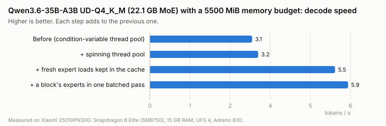
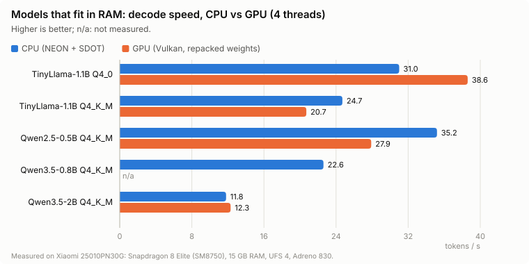
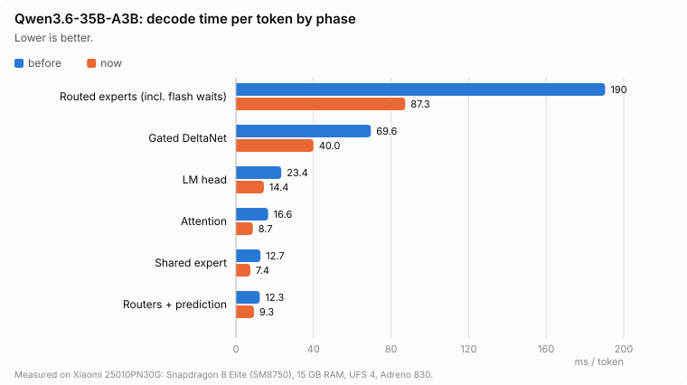
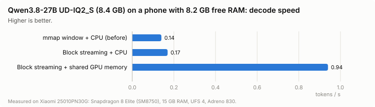
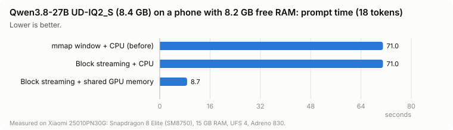
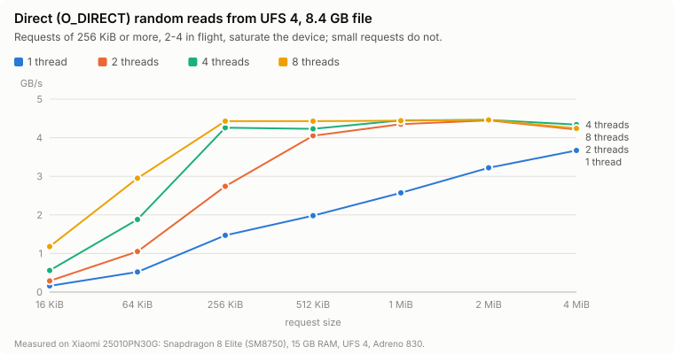
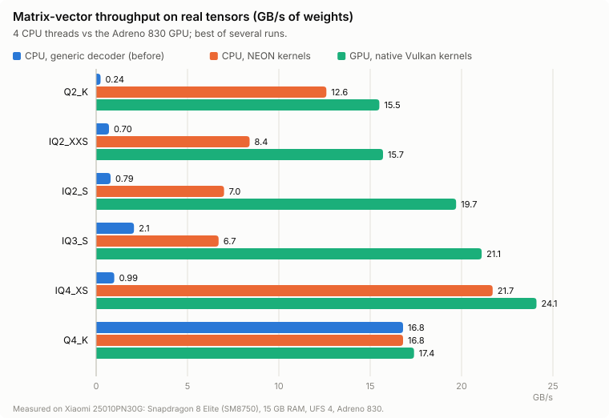

<p align="center">
  
</p>

<p align="center">
  
  
  
  
  
</p>


# Liyab

C++20 inference engine for GGUF models, with a Flutter assistant for Android and macOS.
Run models larger than RAM by streaming weights from storage. Keep chat, tools and inference on the device.

*Liyab* means **flame** in Tagalog.

<a id="contents"></a>

[🚀 Build](#quick-start) · [🧠 Models](#supported-models) · [📊 Speed](#measured-results) · [🧪 Experiments](#experimental-modules) · [📱 App](#the-liyab-app) · [📚 Docs](docs/guide/README.md)

<a id="what-it-does-today"></a>

## ⚡ At a glance

| Use | Available |
| :--- | :--- |
| Inference | GGUF v2/v3, split files, 26 weight formats; dense, MoE, recurrent and latent/sparse attention paths |
| Models larger than RAM | Dense block streaming; bounded MoE expert cache with prefetch and direct I/O |
| Compute | ARM64 NEON / SDOT / i8mm, x86 AVX2 with scalar fallback, Metal, Vulkan |
| Conversations | Context reuse, saved state, paged KV, prefix cache, cancellation and concurrent sequences |
| Generation | Sampling, speculative decoding, JSON/schema constraints and tool calls |
| Pooling and adaptation | Embeddings, reranking and GGUF LoRA adapters |
| Assistant | Chat, model downloads, Android assistant sheet, macOS Option-Space command bar |
| Local API | OpenAI, Anthropic Messages and gRPC; loopback, token authentication, off by default |

✅ Implemented · 🟡 Partial or unverified · 🧪 Experimental · 🔜 Planned

[Full feature inventory](docs/guide/overview.md#what-it-does-today) · [Limitations](#known-limitations)

<a id="measured-results"></a>
<a id="qwen36-35b-a3b-a-22-gb-moe-on-a-phone"></a>
<a id="a-dense-27b-larger-than-ram"></a>
<a id="latent-attention-prefill-mac"></a>
<a id="per-block-kv"></a>
<a id="storage-and-kernels"></a>

## 📊 Speed and measurements

Historical measurements on a **Snapdragon 8 Elite**, UFS 4, HyperOS with a **6 GiB per-app limit**:

| Model | Command line | App | Conditions |
| :--- | ---: | ---: | :--- |
| Qwen3.6-35B-A3B, 22.1 GB UD-Q4_K_M | ~9–10.5 tok/s | ~7.5–9.4 tok/s | Streamed experts; cool phone; CLI budget 5,500 MiB |
| Qwen3.5-4B | ~12 tok/s | ~12–16 tok/s | Fits in RAM |

Temperature, context length and OS activity affect throughput. The [measurement guide](docs/guide/benchmarks.md)
keeps the configurations, alternating A/B runs, single-run caveats and per-phase timings.
Stage-1 phone validation remains deferred; these figures come from earlier device runs.

**M4 Pro, 48 GiB RAM:** Qwen3.8-27B Q4_K_M reached **4.69–4.72 tok/s** with all 64 blocks resident after Metal SiLU FFN fusion. An earlier 13,000 MiB cap run reached **2.54 tok/s** with block streaming. Both used 16-token decode and a 512-token context; prompts differed. [Conditions, A/B runs and phase times](docs/guide/benchmarks.md#m4-pro-dense-27b-development-check).

<a id="charts"></a>

### Decode speed



### Models that fit in RAM



<details>
<summary>More charts: phase timings, dense 27B, flash reads and kernels</summary>











</details>

| More results | Reference |
| :--- | :--- |
| Streaming, expert-cache sizes and GLM-5.2 capacity estimates | [Memory and serving](docs/guide/memory-and-serving.md#models-larger-than-ram) |
| Quantized KV quality, latent attention, per-block KV and kernel timings | [Measurements and correctness](docs/guide/benchmarks.md) |
| Suffix drafts, lookup and tree verification | [Speculative decoding](docs/guide/inference-features.md#speculative-decoding) |
| Embedding, reranking and adapter accuracy / throughput | [Pooling](docs/guide/inference-features.md#embeddings-and-reranking) · [LoRA](docs/guide/inference-features.md#lora-adapters) |
| Raw chart data and regeneration | [results.json](docs/benchmarks/results.json) · `python3 tools/gen_bench_charts.py` |

<a id="quick-start"></a>
<a id="windows-x64"></a>
<a id="cmake-options"></a>

## 🚀 Quick start

| Requirement | Version |
| :--- | :--- |
| Engine | CMake ≥ 3.22; C++20; Clang 17+ / Apple Clang 15+; Ninja recommended |
| Android | NDK r26+ |
| iOS | Xcode 15+ |
| Windows x64 | Visual Studio 2022 C++ tools, MSVC or clang-cl; port awaits a native build |
| Flutter app | Flutter 3.x; Android SDK platform 36 and JDK 17 for Android |

### macOS / Linux

```bash
cmake -S . -B build -G Ninja -DCMAKE_BUILD_TYPE=Release
cmake --build build --parallel 4
ctest --test-dir build --output-on-failure

./build/liyab-cli --device
./build/liyab-cli -m model.gguf -p "Explain unified memory in one paragraph." -n 128
```

<details>
<summary>Android, iOS and Flutter builds</summary>

```bash
# Android engine, CLI and tests
CMAKE_BUILD_PARALLEL_LEVEL=4 scripts/build_android.sh --experimental

# iOS engine framework
scripts/build_ios.sh

# Android app; installation waits while the app is in use
scripts/build_flutter_app.sh --install --serial PHONE_SERIAL

# macOS app, Apple silicon
scripts/build_flutter_app.sh --macos
```

[Build outputs, SDK discovery and platform notes](docs/guide/building.md) · [App build guide](app/README.md)

</details>

<details>
<summary>Windows, Rosetta and CMake options</summary>

| Task | Instructions |
| :--- | :--- |
| Windows x64 | [MSVC / clang-cl commands and port restrictions](docs/guide/building.md#windows-x64) |
| x86-64 under Rosetta | [Build and CPUID setup](docs/guide/building.md#quick-start) |
| Metal / Vulkan / NPU probes / static library / experimental build | [CMake options](docs/guide/building.md#cmake-options) |

</details>

<a id="supported-models"></a>
<a id="architecture-coverage-and-validation"></a>

## 🧠 Models and formats

| Family | Examples / paths | Stage-1 tiny recipes |
| :--- | :--- | ---: |
| Existing attention and hybrids | Llama, Mistral, Qwen2/3/3.5, Hunyuan, ERNIE dense, Gemma 2/3, Phi-3 | Existing regression coverage |
| Classic | GPT-2/NeoX, Falcon, Bloom, StarCoder, Phi-2, OLMo, Command-R, Nemotron, DBRX | 20 |
| Modern dense | SmolLM3, OLMo 2/3, EXAONE, Granite, MiniCPM, InternLM, Gemma 1, Ministral, PLaMo3, Deci | 17 |
| MoE | GPT-OSS, Mixtral, Qwen2-MoE, DeepSeek-MoE, GLM4-MoE, Ling-lite, dots1, ERNIE-MoE, HY3 | 9 |
| State space | Mamba, Falcon-Mamba, Mamba-2, Codestral | 5 |
| Convolution / delta | LFM2, LFM2-MoE, Qwen3-Next, Kimi-Linear | 4 |
| Gemma text / pooling | Gemma 3n, EmbeddingGemma; uniform-geometry Gemma 4 variants | 4 |
| Sparse / group routing | DeepSeek V2/V3/V3.2, GLM-5/5.1/5.2, Ling 2.0 | 7 |

**66 recipes, including one embedding check.** Family names do not establish support for every checkpoint or export.
The [complete architecture table](docs/guide/models.md#architecture-coverage-and-validation) separates trained-model
gates, tiny checkpoints, smoke runs, failed controls and incomplete variants.

| Format / metadata | Support |
| :--- | :--- |
| Model files | GGUF v2/v3; single file or split; open part 1 with the other parts beside it |
| Weights | F32 / F16 / BF16, Q4–Q8, K-quants, I-quants, TQ1_0 / TQ2_0, MXFP4, NVFP4 |
| KV cache | F16, Q8_0, Q4_0, Q4_1; key scaling where measured channel ranges require it |
| Tokenization | SentencePiece, byte-level BPE, raw unigram; source-specific pre-tokenizer rows |
| Chat | GGUF Jinja templates; engine/CLI rendering covers more formats than Flutter replay |

**Export caveats:** OLMo, StarCoder, EXAONE 3.5, InternLM 3 and Ministral have documented tokenizer/template
metadata conflicts. Check the [source/export notes](docs/guide/models.md) before choosing a file.
[`liyab-compat`](docs/liyab-compat.md) adds heterogeneous Gemma 4 text/MoE and DeepSeek-V4 text execution,
including expert output scales folded into weights, checked against generated upstream checkpoints. Trained quality, production tokenizer/export checks and the
[remaining combinations](docs/model-coverage-stage1.md#stage-2-and-later-work) need further validation.

<a id="architecture"></a>

## 🧩 Platforms and engine

| Target | Engine / compute | App / validation limits |
| :--- | :--- | :--- |
| Android ARM64 | ✅ CPU, Vulkan; QNN / NeuroPilot runtime probes | ✅ Flutter app; NPU compute falls back; stage-1 phone checks deferred |
| macOS Apple silicon | ✅ CPU, Metal | ✅ Flutter app and Option-Space bar |
| iOS | ✅ Engine framework | 🟡 Flutter app awaits its first build |
| x86-64 | AVX2 / FMA / F16C with scalar fallback | 🟡 Rosetta correctness checks; native Intel/AMD timings unmeasured |
| Linux | Host build path | 🟡 Native Linux validation and desktop app remain pending |
| Windows x64 | Win32 engine / CLI port, MSVC or clang-cl | 🟡 Uncompiled on Windows; CPU backend; desktop app pending |

| Layer | Responsibility |
| :--- | :--- |
| C++ / C ABI / JNI / Swift / Dart FFI | Engine access from applications |
| [`liyab-compat`](docs/liyab-compat.md) | Load-time metadata/tensor adaptation, architecture facts, validation and block plans |
| Context manager | KV pages, recurrent state, saved contexts, prefix reuse and sequence scheduling |
| Storage | Mapped GGUF tensors, dense block pipeline and bounded expert cache |
| Backends | Per-operation routing, with CPU fallback for unsupported accelerator operations |
| Power manager | Thermal headroom, token pacing, performance hints and emergency guards |

[Architecture diagram, kernel coverage and cache invariants](docs/guide/architecture.md)

<a id="models-larger-than-ram"></a>
<a id="context-memory-and-serving"></a>
<a id="heat-and-power"></a>
<a id="speculative-decoding"></a>
<a id="host-measurements-suffix-drafts-and-context-lookup"></a>
<a id="host-measurements-tree-verification-against-the-best-branch"></a>

## 💾 Memory and serving

| Feature | Behavior | Details |
| :--- | :--- | :--- |
| Models larger than RAM | Dense weights stream when the GGUF exceeds available memory or the app budget after a 1 GiB runtime reserve; the desktop scheduler checks the actual block layout before growing its cap | [Dense / MoE streaming](docs/guide/memory-and-serving.md#models-larger-than-ram) |
| Expert cache | LFU eviction, next-block router prediction, overlapping I/O and compute | [Memory planning and estimates](docs/guide/memory-and-serving.md#models-larger-than-ram) |
| Conversations | Reuse prior tokens; restore saved contexts and shared prefixes; keep recurrent snapshots | [Context and persistence](docs/guide/memory-and-serving.md#context-memory-and-serving) |
| Concurrent sequences | Per-request contexts and adapters; shared decoding passes | [Scheduling and cancellation](docs/guide/memory-and-serving.md#context-memory-and-serving) |
| Speculation | Draft models, context lookup, suffix trees and rollback | [Accuracy and speed measurements](docs/guide/inference-features.md#speculative-decoding) |
| Heat and power | Performance / Balanced / Low Power profiles, thermal pacing and guards | [Profiles and device behavior](docs/guide/inference-features.md#heat-and-power) |

Lossy options include expert skipping, explicit requantization, segment reuse and 4-bit prefix storage.
Their [quality measurements](docs/guide/memory-and-serving.md) remain separate from lossless execution.

<a id="embeddings-and-reranking"></a>
<a id="lora-adapters"></a>

## 🔌 Embeddings and LoRA

| Operation | Interface | Reference |
| :--- | :--- | :--- |
| Embeddings | `Engine::embed()`, C ABI, `liyab-embed`, `/v1/embeddings` | [Pooling, dimensions, task prefixes and cosine checks](docs/guide/inference-features.md#embeddings-and-reranking) |
| Reranking | `Engine::rerank()`, C ABI, `liyab-embed`, `/v1/rerank` | [Ranking heads, prompt rules and score checks](docs/guide/inference-features.md#embeddings-and-reranking) |
| LoRA | Load several GGUF adapters; select one per request; separate adapter contexts | [Targets, memory cap, scaling, refusals and cost](docs/guide/inference-features.md#lora-adapters) |

<a id="using-the-engine"></a>
<a id="c"></a>
<a id="c-abi-liyab_c_apih"></a>
<a id="android-kotlin"></a>
<a id="ios-swift"></a>
<a id="command-line"></a>

## 🛠️ Engine APIs

| Interface | Complete examples and contracts |
| :--- | :--- |
| C++ | [Engine creation, generation, state and pooling](docs/guide/api.md#c) |
| C ABI | [Stable FFI surface](docs/guide/api.md#c-abi-liyab_c_apih) |
| Android / Kotlin | [JNI usage](docs/guide/api.md#android-kotlin) |
| iOS / Swift | [Framework usage](docs/guide/api.md#ios-swift) |
| CLI | [Memory budgets, cache controls, speculation, profiles, LoRA and JSON stats](docs/guide/api.md#command-line) |

<a id="the-liyab-app"></a>
<a id="an-assistant-that-replaces-the-cloud-one"></a>
<a id="fast-where-users-feel-it"></a>
<a id="everything-else"></a>

## 📱 App and local API

| Area | Android | macOS |
| :--- | :--- | :--- |
| Assistant | Default-assistant gesture and overlay sheet | Option-Space command bar |
| Opt-in data tools | Calendar, notifications, SMS, calls, contacts, clipboard | Calendar, Apple Mail, Messages, calls, contacts, clipboard |
| Chat | History, prepared system prompt, typing-ahead prefill, saved conversations | Same Flutter UI and engine scheduler |
| Model library | Hugging Face search, resumable downloads with SHA-256 checks, GGUF import | Same model library |
| Background work | Foreground service; screen-off replies; API listening subject to Android permissions | App stays running with its window closed |

Each data source starts disabled. The engine has no network dependency; the app downloads models from Hugging Face.
Flutter refuses incompatible chat replay, including current GPT-OSS Harmony replay; raw completion and pooling
remain available. [Permissions, replay formats and background behavior](docs/guide/app.md)

<a id="local-api-one-model-for-every-app-on-the-device"></a>

| Local protocol | Address | Calls |
| :--- | :--- | :--- |
| OpenAI | `http://127.0.0.1:8642/v1` | Chat, completions, embeddings, model listing |
| Anthropic Messages | `http://127.0.0.1:8642/v1` | Messages, token counting, model listing |
| Rerank | `http://127.0.0.1:8642/v1` | Reranking, with Jina / Cohere request shapes |
| gRPC | `127.0.0.1:8643` | Model listing, streaming generation, token counting |

Enable **Settings → Local API** and use its token. Servers listen on loopback; tools, reasoning, streaming,
adapter selection and refusal rules follow the [API reference](docs/guide/app.md#local-api-one-model-for-every-app-on-the-device).

<a id="look-and-feel"></a>

<details>
<summary>🔥 Visual design: flame states, thermal colours, typography and assets</summary>



[Colour palette, animation rates, fonts and source files](docs/guide/design.md)

</details>

<a id="experimental-modules"></a>

<a id="what-we-found-along-the-way"></a>

<a id="what-did-not-pay-off-so-you-dont-have-to-try"></a>

## 🧪 Experimental controls

Build with `-DLIYAB_ENABLE_EXPERIMENTAL=ON`. The app build includes these modules; their defaults are off.

| Control | Effect | Measurement | Limit |
| :--- | :--- | :--- | :--- |
| `--early-exit P` | Exit once token confidence exceeds `P`, e.g. `0.98` | +53% with a forced exit at block 6 | Synthetic result; lossy on models without exit training |
| `--prune-heads R` | Keep fraction `R` of heads while hot / on low power | +12% with half the heads at 1,536 context | Lossy |
| `--egls T` | Skip FFN below entropy delta `T`, e.g. `0.002` | +5–48% on TinyLlama | Early output divergence; needs training |
| `--tdss hot\|always` | Use 2:4 magnitude-pruned FFNs | −54% decode on the phone | Slower without sparse units |
| JIT unpacker | Emit AArch64 NEON row-unpack routines, W^X | +37% for a 4,096-element row | Component result; outside the hot path; unavailable on iOS |
| io_uring loader | Direct reads through raw io_uring syscalls | No Android result | Android apps cannot call `io_uring_setup` |

[Module internals, API configuration and legacy KV-dedup behavior](docs/guide/development.md#experimental-modules) · [Experiments that did not pay off](docs/guide/benchmarks.md#what-did-not-pay-off-so-you-dont-have-to-try)

<a id="testing"></a>
<a id="regression-run-on-the-phone"></a>
<a id="where-a-process-spends-its-cores"></a>

<a id="correctness"></a>

## ✅ Validation

| Stage-1 integration check | Result |
| :--- | :--- |
| Native ARM64 / Rosetta scalar / Rosetta AVX2 | 16/16 tests on each target |
| Golden logits | 138 cases × 3 platforms = 414 pins; original pins unchanged |
| Merged tiny conformance | 66/66 recipes, including one 39-input embedding case |
| Recurrent quantization proofs | 520 cases: 26 formats × 5 mixers × 4 KV types |
| Mapped per-layer embeddings | 104 cases: 26 formats × 4 KV types |
| Android experimental build | Complete; 15 phone-test binaries built |
| Flutter | 53 passed; 2 optional real-model tests skipped |
| Main / integration performance | 72 measured pairs; 21 metrics within ±3% (−2.088% to +0.617%); identical replies and counts |
| Stage-1 phone checks | Deferred; host results do not establish device validation |

[Per-architecture results and failed controls](docs/model-coverage-stage1.md) · [Test suites and commands](docs/guide/development.md#testing) · [Phone regression procedure](docs/guide/development.md#regression-run-on-the-phone) · [Reproduction archive](docs/validation/models-stage1/README.md)

<a id="known-limitations"></a>

## ⚠️ Limits to check

| Area | Current limit |
| :--- | :--- |
| Model coverage | Gemma 4 / DeepSeek-V4 text have synthetic conformance; trained quality, production exports and other stage-2 combinations remain unverified |
| Export metadata | Some published tokenizer / template metadata needs a corrected copy |
| GPU behavior | Thermal CPU rerouting can change rounding; BF16 Metal matrix work falls back to CPU |
| Vulkan | Per-token prefill matvec; resident tensors copied to GPU memory; MoE experts on CPU |
| NPUs | Runtime detection and ranking; compute fallback |
| Pooling | Decoder / bidirectional Gemma pooling paths; encoder-only models pending |
| LoRA | CPU updates; sliced latent/grouped projections, token embeddings and activated LoRA refused |
| Local API | Text input; one loaded model; gRPC generation; tool formats restricted to supported ChatML templates |
| Ports | Windows uncompiled, native x86/Linux validation pending, iOS/Linux/Windows apps pending |

[Complete limitations: KV, snapshots, rotary variants, kernels, grammar and platform details](docs/guide/development.md#known-limitations)

<a id="roadmap"></a>

## 🗺️ Next work

| Track | Planned work |
| :--- | :--- |
| Model coverage | Stage-2 compositions, starting with Flint; unsupported converters; later multimodal input |
| Compute | Fewer CPU/GPU synchronizations, operation fusion, CPU/GPU overlap, GPU LoRA |
| Serving | Multi-row float kernels, sequence page sharing, draft-guided expert prefetch |
| Assistant | Voice, confirmed actions, local memory / retrieval, small-and-large model tiers |
| Platforms | Native build validation, desktop ports, iOS app, NPU kernels and localization |

[Full ordered roadmap](docs/guide/development.md#roadmap) · [Stage-2 dependencies](docs/model-coverage-stage1.md#stage-2-and-later-work)

<a id="why-liyab"></a>
<a id="design-principles"></a>

<details>
<summary>Project goals and engineering rules</summary>

| Rule | In practice |
| :--- | :--- |
| Generic planning | Describe models through registry facts, metadata and tensors |
| Device calibration | Measure scheduling, memory and thermal policy on the device |
| Lossless defaults | Label output-changing options and measure their KL cost |
| Measured changes | Alternate A/B runs; retain conditions and failures |
| Local data | Run inference and user-data tools on the device |

[Project goals and full design principles](docs/guide/overview.md)

</details>

<a id="project-layout"></a>
<a id="contributing"></a>

## 📚 Documentation and contributing

| Start here | Contents |
| :--- | :--- |
| [Documentation index](docs/guide/README.md) | Build, architecture, models, memory, APIs, app, design, benchmarks and development |
| [Source map](docs/guide/development.md#project-layout) | Public headers, core, backends, tools, tests, app and scripts |
| [Adding a model](docs/guide/development.md#contributing) | Registry facts, reference tracing, conformance and golden cases |
| [Contribution guide](CONTRIBUTING.md) | Development workflow and review requirements |
| [Model descriptions](docs/model-descriptions.md) | Source facts, trained checkpoints and export corrections |
| [Cold-expert study](docs/research/cold-experts.md) | Quality / storage trade-offs for rarely used experts |

[Report a security issue](SECURITY.md) · [Code of conduct](CODE_OF_CONDUCT.md) · [Citation](CITATION.cff)


## License

Apache 2.0. See [LICENSE](LICENSE) and [third-party notices](THIRD_PARTY_NOTICES.md), including the MIT-licensed
llama.cpp / ggml adaptations used by the low-bit NEON kernels.
